<div align="center">

<h1>ai-usage</h1>

<p><strong>How much of your Claude Code, Codex, and Grok quota is left, for you and every machine on your team,<br>and whether it lasts until the reset.</strong></p>

<a href="https://github.com/neoromantic/ai-usage/releases/latest"></a>
<a href="https://github.com/neoromantic/ai-usage/actions/workflows/ci.yml"></a>
<a href="LICENSE"></a>
<a href="https://t.me/usualguy"></a>

<p>
<a href="https://au.sergeybaus.com"><b>Website</b></a> ·
<a href="#quick-start"><b>Quick start</b></a> ·
<a href="#what-it-shows"><b>What it shows</b></a> ·
<a href="#cost"><b>Cost</b></a> ·
<a href="#install"><b>Install</b></a> ·
<a href="#teams"><b>Teams</b></a> ·
<a href="#privacy"><b>Privacy</b></a> ·
<a href="#json-for-agents"><b>JSON for agents</b></a> ·
<a href="#commands"><b>Commands</b></a>
</p>

</div>


<p align="center"><sub>A made-up team: two laptops, a Linux server, and nine bots on one Codex login. <a href="#what-it-shows">The whole page</a> · <a href="docs/demo">more pictures</a></sub></p>

ai-usage is one small binary for macOS, Linux, and Windows. The system scheduler runs it every 15 minutes. Each run reads what Claude Code, Codex, Grok, and Hermes already record on disk, asks the installed tools for your account and quota, and exits. Machines that share a team key see each other through a small relay, which sees the numbers but not the names.

## Highlights

- **Every subscription on one page.** Claude Code and the Claude app's agent-mode sessions, Codex from its CLI, the ChatGPT app, or an IDE extension, Grok, and Hermes. Each account shows its 5-hour, weekly, and per-model windows, and its tokens today and over 7, 30, and 90 days, weighed by what the API charges for each kind.
- **A forecast, not just a percentage.** Each window says how full it will be at its reset at your pace, the average since it began or the last day's when that is faster: `over`, `tight`, `ok`, or `under`. An `over` window says when it runs out.
- **How full each window got before it reset,** over the last 90 days, for every account in the team: a subscription that runs out week after week, or one mostly left unused.
- **What the subscriptions cost,** a month, from a price list or the price you typed: how much of it the team used over the last 4 weeks, which machine used it, in dollars, when each one charges next, and which ones nobody uses or can say are still paid. See [Cost](#cost).
- **ATTENTION, only when something is wrong.** A full window, one that will run out before its reset, a machine whose tool fails or that stopped reporting, an old release, a subscription nobody uses.
- **The whole team.** Laptops, servers, and bots in containers, every machine against every subscription, with each one's share. A colleague joins with one command. See [Teams](#teams).
- **Private by design.** The relay sees tools, plans, and numbers. Names, emails, and project paths are encrypted with the team key, and every snapshot is signed. ai-usage also sends its author [usage stats](#usage-stats), never your accounts, projects, or numbers; `ai-usage telemetry off` stops them. See [Privacy](#privacy).
- **Nothing to run or look after.** No daemon, no account, no config file. It installs with one line or with Homebrew, and schedules itself. A script install updates itself; a Homebrew one updates with `brew upgrade` or `ai-usage update`.
- **Spends none of your quota.** It asks the tools you already have instead of calling Anthropic, OpenAI, or xAI, and never reads your credentials. Asking Claude Code for its usage spends no tokens. See [Other data folders](#other-data-folders).
- **A menu bar app on macOS.** A ring in the menu bar shows what is left; a click says what is out or runs out, and when, and a notification says it once as it happens. See [Menu bar app](#menu-bar-app).
- **A plugin for BB,** which shows the team report on a page and installs ai-usage where it is missing. See [In BB](#in-bb).
- **JSON for agents,** with a versioned schema, so an agent can pick the account with room. See [JSON for agents](#json-for-agents).

## Quick start

```sh
curl -fsSL https://raw.githubusercontent.com/neoromantic/ai-usage/main/install.sh | sh
```

That line installs `ai-usage`, registers it with launchd or cron, and prints your report. On macOS 14 and later it also installs the [menu bar app](#menu-bar-app).

Or, from v0.8.0, with [Homebrew](#homebrew) on macOS or Linux:

```sh
brew install neoromantic/tap/ai-usage
ai-usage               # collect, register with launchd or cron, and print the report
ai-usage app install   # on macOS 14 and later, the menu bar app
```

From then on:

```sh
ai-usage             # collect now and open the page
ai-usage team key    # print the key a colleague installs with to join your team
```

A colleague joins your team with that key:

```sh
curl -fsSL https://raw.githubusercontent.com/neoromantic/ai-usage/main/install.sh |
  AI_USAGE_TEAM_KEY='aiu-team-1:…' sh
```

Questions, ideas, a tool you want supported: write me on Telegram, [@usualguy](https://t.me/usualguy), or [open an issue](https://github.com/neoromantic/ai-usage/issues).

## Contents

- [What it shows](#what-it-shows), and what the subscriptions [cost](#cost)
- The [menu bar app](#menu-bar-app), and AI Usage [in BB](#in-bb)
- [Install](#install) and the [first run](#first-run)
- [Teams](#teams) and the [relay](#relay)
- [Commands](#commands)
- [Other data folders](#other-data-folders), and ai-usage [in a container](#in-a-container)
- [JSON for agents](#json-for-agents)
- [Privacy](#privacy)
- [Updates](#updates), [troubleshooting](#troubleshooting), [uninstall](#uninstall), and [building from source](#build-from-source)

## What it shows

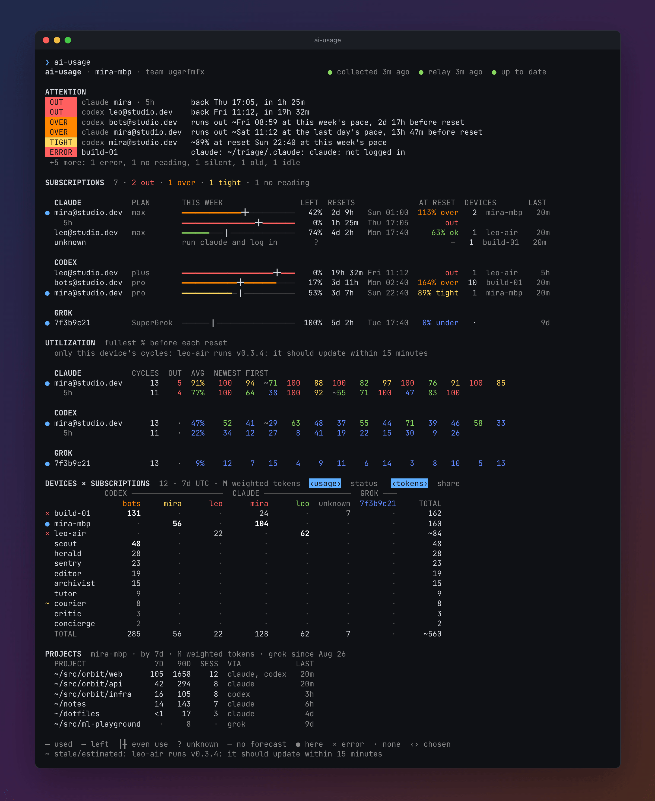

The team in the picture is made up. [docs/demo](docs/demo) has its report and more pictures, and `ai-usage report --from docs/demo/team.json` shows it in your terminal.

<details>
<summary>The same page as text, for another made-up team</summary>

```
ai-usage · ann@annbook · team qmvrtzpa                      ● collected 7m ago  ● relay 7m ago  ● up to date  $1,000/mo

ATTENTION
 OUT      codex ann@acme.dev   back Fri 17:09, in 1d 23h
 OUT      claude ann · Fable   back Sun 01:00, in 3d 7h
 OVER     claude ann@acme.dev  runs out ~Thu 01:17 at this week's pace, 2d 23h before reset · reading 1d old
 OVER     codex sam@mail.test  runs out ~Sat 03:01 at the last day's pace, 2d 17h before reset
 OUTSIDE  codex lee@corp.test  +25 points in 20h, no team device spent
 ERROR    kim@Mac.localdomain  codex: app-server exited without answering
 +7 more: 1 no reading, 1 duplicate, 1 old, 1 check, 3 cost

SUBSCRIPTIONS  7 · 2 out · 1 over · 3 no reading

  CLAUDE         PLAN        THIS WEEK                 LEFT  RESETS              AT RESET  DEVICES                 LAST
● ann@acme.dev   max         ━━━━━━━━━╋━━━━━━────────  ~33%  3d 7h  Sun 01:00  ~174% over   2  ann@annbook           7m
    Fable                    ━━━━━━━━━━━━╋━━━━━━━━━━━    0%  3d 7h  Sun 01:00         out
  kim@corp.test  max         update Claude Code or p…     ?                             —   1  kim@Mac.localdoma…    1h

  CODEX
● ann@acme.dev   pro         ━━━━━━━━━━━━━━━━━╋━━━━━━    0%  1d 23h Fri 17:09         out   2  ann@annbook           1h
  sam@mail.test  prolite     ━━━━━━╋━━━──────────────   58%  5d 2h  Mon 20:12   165% over   1  sam@MacBook-Pro-K…    3h
● lee@corp.test  pro         ━━━┃────────────────────   88%  5d 22h Tue 16:30      81% ok  11  root@srv1            34m
  unknown                    ┈┈┈┈┈┈┈┈┈┈┈┈┈┈┈┈┈┈┈┈┈┈┈┈     ?                             —   1  kim@Mac.localdoma…   16m

  GROK
● a4c2e917       SuperGrok…  ┈┈┈┈┈┈┈┈┈┈┈┈┈┈┈┈┈┈┈┈┈┈┈┈     ?                             —   1  ann@annbook          11h

COST  $1,000/mo +1 without a price · used ~$787 (79%) over the last 4 weeks · next: Fri 25 Sep, $200

  CLAUDE            PLAN             $/MO   USED       NEXT
● ann@acme.dev      Max 20x          $200   $182  91%  Fri 25 Sep
  kim@corp.test     max                 ?      ?  64%  ·
  old@acme.dev      Pro               $20     $0   0%  ·           still paid?

  CODEX
● ann@acme.dev      Pro 200          $180*  $155  86%  Mon 12 Oct
  sam@mail.test     Pro 100          $100    $94  94%  ·           typed for plus
● lee@corp.test     Pro 200          $200    $56  28%  ·
  ann+old@acme.dev  Plus              $20     $3  15%  ·           ended

  GROK
● a4c2e917          SuperGrok Heavy  $300      ?       ·

UTILIZATION  fullest % before each reset
  only this device's cycles: ci@ci-runner-eu-west-build-pool-node-0042ab runs v0.3…: it should update within 15 minutes

  CLAUDE         CYCLES  OUT  AVG  NEWEST FIRST
● ann@acme.dev       13    5  86%   100  100   92  ~78  100   64   88  100   71  ~45   96  100   83
    Fable             3    1  64%   100   62  ~30
    5h               12    2  59%    38  100   71  ~52   90   12   64  100   41   77    8   55

  CODEX
● ann@acme.dev        6    2  86%   100   87   93  100   58   76
  sam@mail.test       4    1  94%    97   91  100  ~88
● lee@corp.test       9    ·  28%    22  ~35   18   40   27   31   12   44   19

DEVICES × SUBSCRIPTIONS  15 · 7d UTC · M weighted tokens              ‹usage›  status   ‹tokens›  share   $
                        CODEX ─────────────────────────────  CLAUDE ──────────  GROK ───  NO QUOTA
                             lee      ann  unknown      sam       ann      kim  a4c2e917    hermes     TOTAL
  root@srv1                 1080       53        ·        ·        25        ·         ·        49      1207
● ann@annbook                  ·      810        ·        ·       230        ·        17         ·      1057
× kim@Mac.localdomain          ·        ·      427        ·         ·      125         ·         ·       551
↓ sam@MacBook-Pro-Kim          ·        ·        ·      269         ·        ·         ·         ·       269
  hermes@bot-a               135        ·        ·        ·         ·        ·         ·         ·       135
  hermes@bot-b               113        ·        ·        ·         ·        ·         ·         7       119
  hermes@bot-c                72        ·        ·        ·         ·        ·         ·         4        76
  hermes@bot-d                54        ·        ·        ·         ·        ·         ·         ·        54
  hermes@bot-e                41        ·        ·        ·         ·        ·         ·         ·        41
  hermes@bot-f                32        ·        ·        ·         ·        ·         ·         ·        32
  hermes@bot-g                18        ·        ·        ·         ·        ·         ·         ·        18
↓ ci@ci-runner-eu-wes…        18        ·        ·        ·         ·        ·         ·         ·       ~18
  hermes@bot-h                 9        ·        ·        ·         ·        ·         ·         ·         9
  hermes@bot-i                 2        ·        ·        ·         ·        ·         ·         ·         2
~ kim@Mac.localdomain          ·        ·        ·        ·         ·        ·         ·         ·         ·
  TOTAL                     1572      863      427      269       256      125        17        59     ~3586

PROJECTS  ann@annbook · by 7d · M weighted tokens · claude since Sep 2
  PROJECT                                            7D   90D  SESS  VIA            LAST
  ~/src/acme/app                                    975  3465    14  codex, claude    1h
  ~/notes                                           194   585    18  codex            3h
  ~/src/ai-usage                                     98    98     1  claude, grok     7m
  ~/src/site                                         82   279     2  codex            2d
  ~/src/acme/os                                      36   105     1  claude, grok    11h
  ~/dotfiles                                         17    41     1  codex, claude    4d
  ~/scratch                                          17    36     1  claude           5d
  ~/src/acme/relay                                   14    41     1  codex            1d
  ~/Library/Mobile Documents/…/Notes/Projects/2026    7    24     1  claude           6d
  ~/src/acme/landing                                  4    32     1  codex            6d
  + 4 more

━ used  ─ left  ┃╋ even use  ┈ no reading  * typed  ? unknown  — no forecast  ● here  × error  ↓ old  · none  ‹› chosen
~ stale/estimated: ci@ci-runner-eu-west-build-pool-node-0042ab runs v0.3.4: it should update within 15 minutes
```

</details>

The header names this machine and the team, and says whether collection, the relay, and self-update are healthy; when one of them fails, its error is in ATTENTION. The relay's age is the older of the last push and the last read of the team, and its dot turns yellow once the team was last read over an hour ago. ATTENTION appears only when something is wrong: a subscription that is out, or will run out by its reset at its pace; one logged in on this machine that will end its window nearly full; one whose window fills while no team machine spends on it; a machine whose collector or one of its tools fails, or that has not reported for a day; a subscription in use with no reading, with why and what to do, which for tokens no login was known for names the machine, and the folder, where the tool says nobody is logged in; a reinstalled machine's old record; machines on an older release; a subscription past half its window that will be left mostly unused; and, dim, a paid subscription no team machine has used for a week, which is IDLE in place of that. An OVER line whose time has passed with nobody on the team spending on the subscription since says it "would run out" then, with the reading's age, as nothing says it did.

SUBSCRIPTIONS has one row per Claude, Codex, and Grok account, grouped by tool, the worst first. The bar is the weekly window: the heavy line is what has been used, and the tick how much would be used by now if the window were spent evenly. LEFT is what is left, RESETS when it resets, and AT RESET how full it will be then at its average pace since the window began, or since it was last at 0%, or at the last day's pace when that is faster, what it gained since the newest reading a day old. Each is measured over a day at least, or a tenth of a window shorter than a day, so a busy first morning does not read as the pace of the week, and before then the forecast shows only when it is over already: `over` at 100% or more, which means it runs out by its reset, `tight` from 85%, `ok` from 50%, and `under` below that. A window that limits the account more than the weekly one, such as a model's window or a full 5-hour window, gets an indented row of its own. `~` marks a reading over 6 hours old, unless the window is full, since a full window stays full until it resets. `?` marks an account with no reading, a window that has reset since it was read, or a Claude 5-hour or weekly window that a refused request did not read. When a machine the account is logged in to says why it has no reading, the reason takes the bar's place, what to do first, such as `update codex` for a Codex too old to read its limits, `run codex login` for a login Codex refused, or that Grok has logged no credit usage yet; the JSON's `no_reading` has it whole, with the machine. DEVICES counts the machines that used the account in this window and names the busiest. Hermes is a tool, not a subscription: what it spends through a Codex or Grok login counts as that login's use.

UTILIZATION is how full each subscription's windows got before each reset over the last 90 days: the fullest reading of each period, so a window that ran out stays at 100% even when the provider reset it early or took usage back. An account's row is its main window, the weekly one, with its other windows, such as a model's or the 5-hour one, indented under it. CYCLES counts the periods that ended, OUT those that ran out, and AVG is their average; then comes each period's percent, newest first, colored as AT RESET is: out at 100%, tight from 85%, ok from 50%, and under below that. `~` marks a period last read more than 6 hours before it ended, or a quarter of a shorter window, as when the laptop slept, so it may have got fuller. A period read only at 0% is left out, and so is one that ended over 90 days ago and, of a window shorter than a day, any but the newest 12. Narrower, the section shows fewer periods, then drops CYCLES. The team takes each period's fullest reading from every machine that read it; see [Teams](#teams).

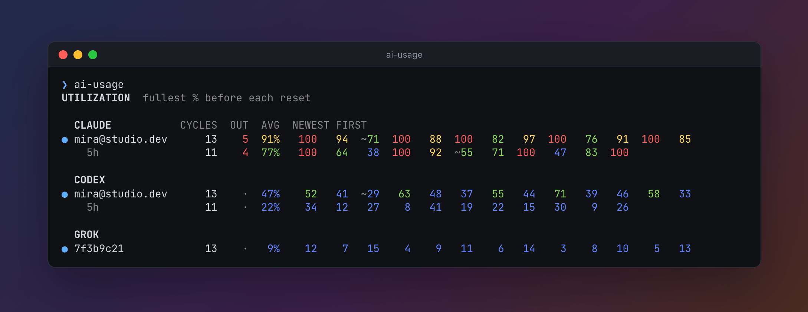

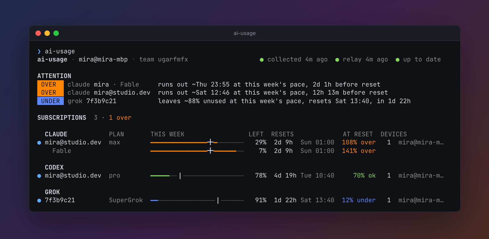

DEVICES × SUBSCRIPTIONS is every machine against every subscription, in millions of weighted tokens over the last 7 UTC days. A weighted token weighs each kind of token by what the provider's API charges for it against input: Claude's output 5, a cache read 0.1, and a cache write 1.25, or 2 when it is kept an hour; Codex's output 8 and a cache read 0.1; Grok's output 5 and a cache read 0.25. So a session that rereads a large cache shows more than its input and output, and less than every token counted alike. It is a proxy for how much quota a session uses, not the provider's formula. NO QUOTA holds the tokens no subscription covers, such as Hermes on an API key. Columns that do not fit fold into REST, so each row's cells add up to its TOTAL. A machine on a release before v0.4.0 sends no weighted tokens, so its are estimated from its input and output: `~` marks its TOTAL and the team's, and the legend says why and what to do. The section has a second view, status: a row per machine with its release, how long ago it reported, the tools it reads, its tokens today and over 7, 30, and 90 days, and a note of what is wrong with it, such as an error, an update to install, or why it does not update itself. `--devices` prints that view. With only this machine, the section is USAGE instead: a row per subscription, with today, 7 days, 30 days, and 90 days. PROJECTS lists this machine's top projects over every account; `--projects` lists all of them. A project is a git repository, with its subfolders and worktrees, those Claude Code and Codex make included; a folder outside any repository counts under the nearest folder above it that the tools worked in, and is a project of its own when there is none, never reaching up to the home folder, Downloads and folders like it, or a temporary folder. USAGE and PROJECTS count this machine's local days, and 7, 30, and 90 days as rolling hours, while the team's tables count UTC days, as machines send them, so this machine's own row there can differ. Today is the exception once every machine runs v0.7.0 or later: each sends its tokens by hour for the last two days, so the team's today counts from your own midnight, wherever each teammate is, and the title says `today` without `UTC`. Where the ledger holds less than 90 days of a tool, as when Claude Code deleted older transcripts, the PROJECTS title says since when. A dim legend at the bottom explains only the marks on screen.

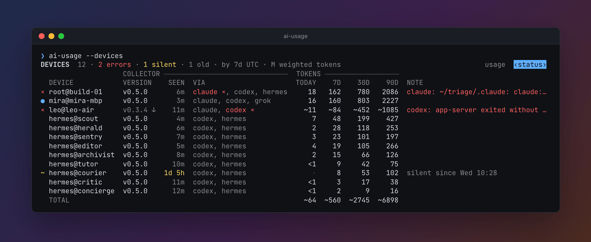

The matrix shows accounts by short names: the part of an email before the `@`, or the first 8 characters of an id. `ai-usage alias` gives an account a name for the whole team; see [Teams](#teams).

When standard input and output are both terminals, `ai-usage` opens the same page as an interactive view. It scrolls, with the head of DEVICES kept at the top while its rows go by, and the matrix scrolls sideways; `s` switches DEVICES between the matrix and the status view, `p` picks the period (today, 7, 30, or 90 days), `%` shows each machine's percent of each subscription's tokens in the period, and in TOTAL of all the team's, `$` what each machine used of each subscription in dollars, as [Cost](#cost) says, `r` collects now, `?` lists every key, and `q` quits. `Enter` picks a row, an account or a machine, a bot's container included, and `↑` `↓` move the pick; `Enter` again, or a click on the picked row, opens its detail in the page's place, and `Esc` or `Backspace` goes back. An account's detail has its ATTENTION lines, the reading and where it came from, each window with its bar, reset, forecast, pace, and when it runs out at that pace, how full each window got before its last resets, every machine that spent it, in its current window and over each period, with its share of the account, and this machine's projects on it. A machine's detail, under its name such as `hermes@scout`, has its ATTENTION lines, its release, last report, the tools it reads and each error in full, every account it spent with its share of each, its share of the team's tokens, and, for this machine, its projects. Piped output, `--json`, `--plain`, and `TERM=dumb` print the page instead, and so does the installer's first run. The page is at its best at 120 to 160 columns; narrower, it drops columns in a fixed order, down to 80.

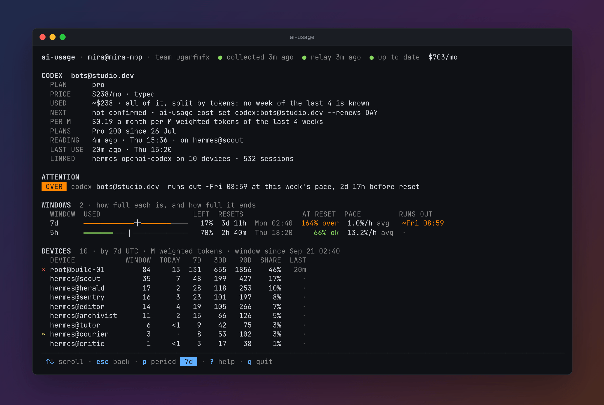

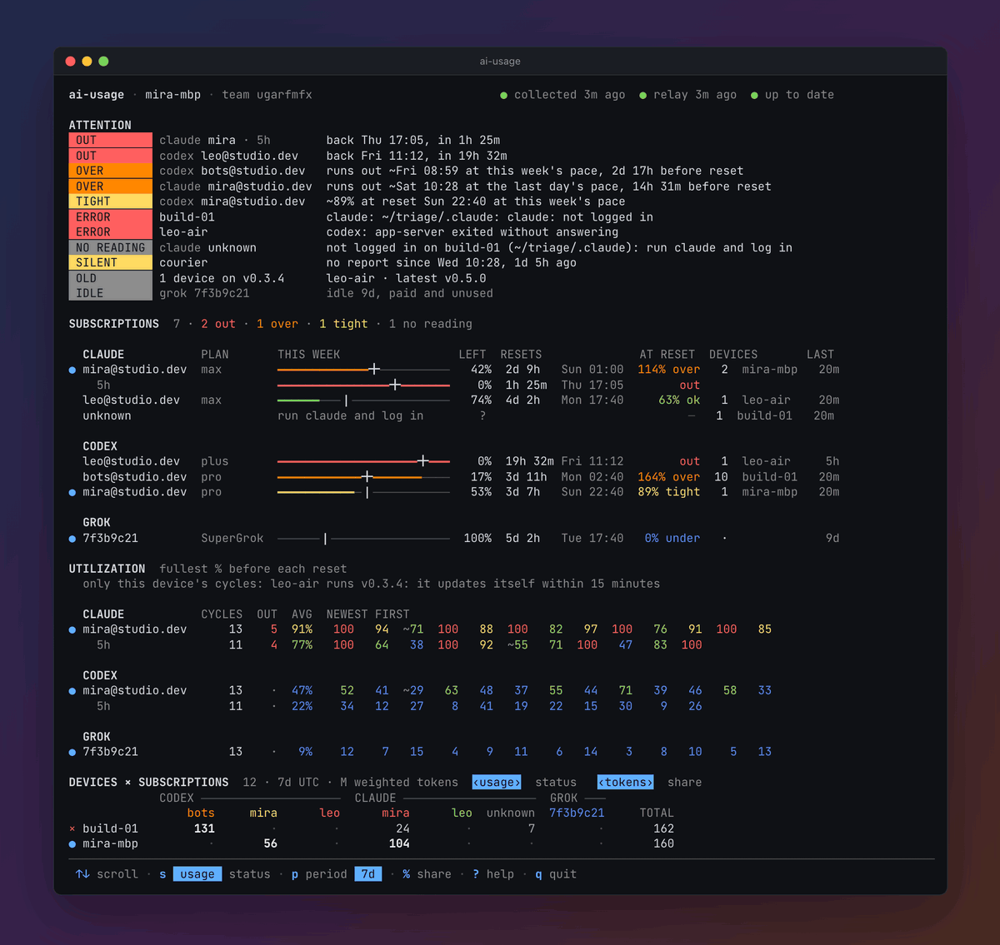

## Cost


COST, after SUBSCRIPTIONS, is what the team's Claude, Codex, and Grok subscriptions cost a month: a budget, not accounting. Its first line is the team's total a month, which also ends the header, how much of it the team used over the last 4 weeks, and the next charge. Then a row per subscription, grouped by tool:

- **PLAN** as the price list names it.
- **$/MO**, the price a month: the list price of the plan, or the price a person typed, marked `*`; a plan billed yearly counts a twelfth of the year's price. `?` marks a plan the list has no price for, such as a team, business, enterprise, or education plan, or a Claude Max whose tier an older release did not read, and the first line counts them. A price typed for another plan no longer counts: the row says `typed for max 5x`, and the list's price counts until someone types the new one. Prices are the providers' US list prices in USD; a Claude subscription billed through the App Store or Google Play may cost more there, and its detail says so.
- **USED**, in dollars and percent: how much of the price the team used over the last 4 weeks. Each week counts as full as the subscription's weekly window got before it reset, or the longest window of a day or more its tool has, never Claude's 5-hour one; a week with no reading and no tokens counts 0%, and a week with tokens but no reading is left out, and so is a week before the team first found the subscription. After a change of plan, each week counts at the price of its plan. When no week is known, as when the subscription is new or the machines that used it run a release that sends no quota cycles, USED is `?`, and the matrix in dollars splits the whole price by tokens, marked `~`.
- **NEXT**, the next charge, once a person said when it charges: the same day each month, the last day of a shorter month, or the same date each year.
- What is wrong, when something is: `idle 9d`, a paid subscription no team machine used for a week; `still paid?`, when nobody can say, because its plan was last confirmed by a reading of its quota over 35 days ago, or no machine has had it logged in for 14 days, and nobody confirmed it in the last 35 days; and `ended`, when a reading found a free plan or a person cancelled it. An ended subscription counts in no total and goes after 30 days. A subscription stays in COST after the last machine that had it is gone, until it ends, so one nobody uses cannot drop out of the cost.

ATTENTION gives IDLE its price, "idle 9d, $25/mo paid and unused"; asks CHECK of a subscription nobody can say is still paid, "still paid? last confirmed 21 Aug · no device since 21 Aug: ai-usage cost confirm claude:jun@studio.dev or cancel"; and for 3 days says COST when a subscription is new, its plan changed, as "plan Max 5x → Max 20x, +$81/mo", or the list price of its plan changed. Hermes borrows a Claude, Codex, or Grok login, so what it spends counts as that login's use, and it costs nothing of its own.

In the interactive view, `$` shows DEVICES × SUBSCRIPTIONS in dollars over the last 4 weeks: a cell is what the machine used of the subscription, its part of the subscription's weighted tokens times the dollars used; `unused` is what nobody used, and the TOTAL row is each subscription's price, so every column adds up to it, and the TOTAL column to the row; a line under it says what COST counts that no machine has, and the subscriptions without a price. `%` goes from dollars to shares. A subscription's detail adds its price and where it comes from, used and unused, the next charge, its state, who bills it, its price for a million weighted tokens, its plans, and what each machine used of it; a machine's detail adds what it used of each subscription, and in all.

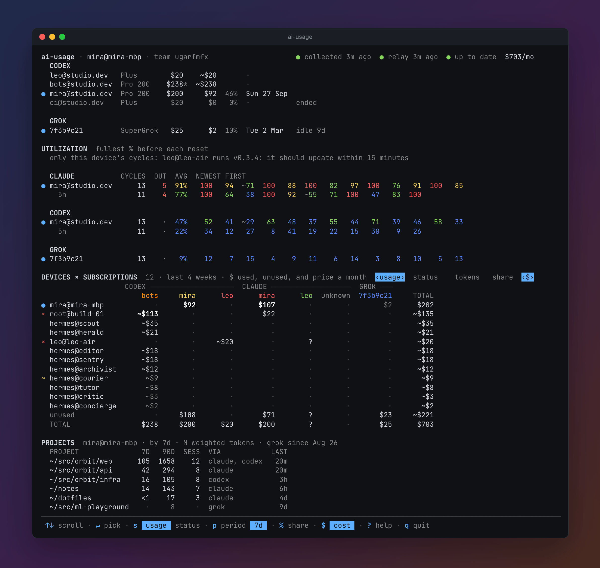

**Questions.** ai-usage asks a person what no tool says: when a subscription logged in on this machine charges next, and whether monthly or yearly when the list prices its plan yearly too, with the day Claude Code says the subscription began as a suggestion; its price, when the list has none, offering the list's tiers when a plan was read without its tier, as Claude's Max from an older release; and, on every machine, whether a subscription nobody can confirm is still paid. The interactive view asks one at a time, on the line over the key bar: type the answer, `Enter` takes the suggestion, `y` or `n` says whether it is still paid, `s` skips the question, `S` asks no more on this machine, and `Esc` asks later. The first run on a terminal asks them after the guide, the [menu bar app](#menu-bar-app) asks in a notification and in Settings, and the [BB plugin](#in-bb) on its page. A skipped question is not asked again of that subscription, except a charge day or a price after its plan changes. A scheduled run, a run without a terminal, and `--json` ask nothing. `e` on a picked or open subscription asks for its cadence, price, and next charge.

```sh
ai-usage cost                                           # COST, and what each machine used
ai-usage cost --json                                    # the report's cost object
ai-usage cost set claude:ann@acme.dev --renews 12       # charges on the 12th of each month
ai-usage cost set codex:bots@acme.dev --price 238       # what each charge costs, here with VAT
ai-usage cost set grok:ann@acme.dev --yearly --price 300 --renews 2027-03-02
ai-usage cost confirm claude:jun@acme.dev               # still paid
ai-usage cost cancel codex:ci@acme.dev                  # cancelled: ended from now
ai-usage cost reset codex:bots@acme.dev                 # back to the list price
ai-usage cost skip claude:ann@acme.dev renewal          # never ask this again
ai-usage cost never-ask                                 # ask nothing on this machine; --undo asks again
ai-usage cost prices                                    # the price list in use, its date, and where it came from
```

ACCOUNT is a label, a name, or `PROVIDER:LABEL`, as for `ai-usage alias`. A price is what each charge costs, so with `--yearly` it is the year's. What a person types travels sealed in this machine's snapshot, so the whole team sees it after this machine's next run, and for each answer the newest from any machine counts. It travels only once every machine in the team runs v0.10.0 or later; until then, it counts on the machine it was typed on.

**Prices.** The price list is built into ai-usage, each price with the page it was checked on, and the relay serves its own copy. Once a day each collector asks the relay for the list and keeps whichever of the two was checked later, so a price fixed in this repository reaches every machine within a day, without a release, and a weekly check against the providers' pages says when one needs fixing; a failed ask says nothing, and the built-in list serves. When the list price of a plan changes, the new price counts from then on, and `ai-usage cost set ACCOUNT --price N` keeps the old one.

## Menu bar app

On macOS 14 and later, the installer also puts AI Usage, a menu bar app, in `~/Applications` and opens it. With Homebrew, or after an install without it, `ai-usage app install` adds it; it then follows `ai-usage`. It starts at login and updates with `ai-usage`. Releases after v0.8.0 sign the app, like the `ai-usage` binary for macOS, with Developer ID and have Apple notarize it, so macOS opens it however it got to the Mac, even unzipped from `ai-usage_darwin_app.zip` downloaded in a browser.

<picture>
  <source media="(prefers-color-scheme: light)" srcset="docs/demo/menubar-light.png">
  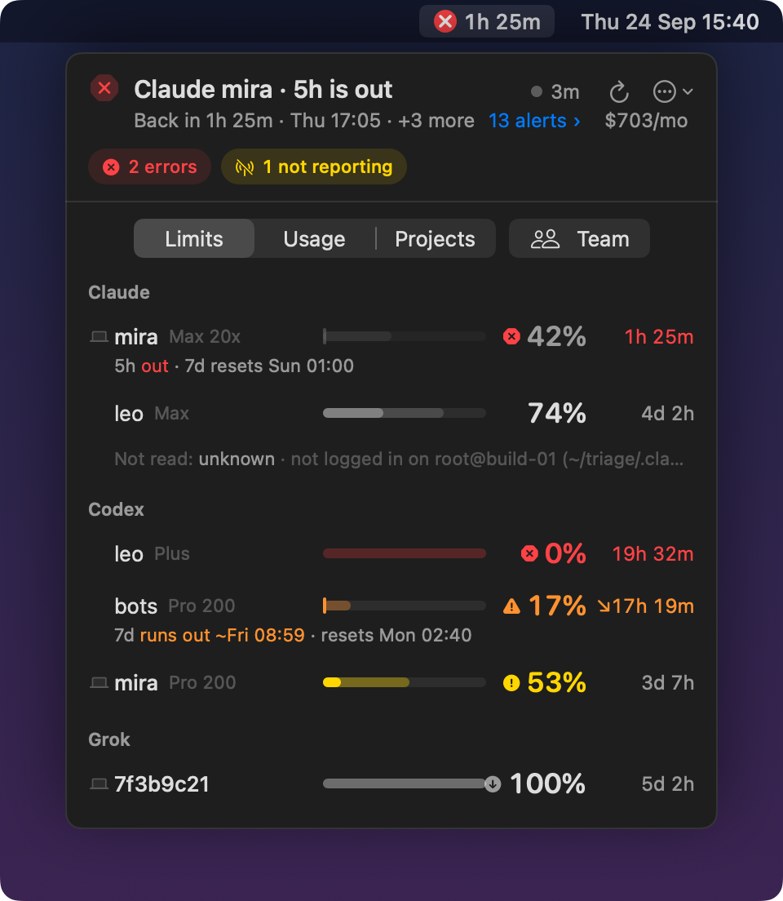
</picture>

**The menu bar** shows a ring of what is left of the fullest window among the subscriptions logged in on this Mac, or among the team's when Settings' Track says so, with its percent left. The ring turns orange when the window will run out before its reset, and red with the time until it is back when it is out. Settings can show the time until reset instead, or the ring alone.

<picture>
  <source media="(prefers-color-scheme: light)" srcset="docs/demo/app-menubar-light.png">
  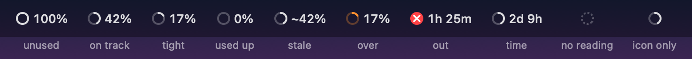
</picture>

**The popover** opens with one line that answers the first question: what is out and when it is back, what runs out and when, or that all is on track and where the most room is. When the report has more to say, the line ends with a link, "11 alerts ›", to every entry of its ATTENTION, in its order and its words, in place of the tab: one line each with the mark of its kind, a click opening the subscription in Limits or the devices in Usage, and last the subscription with the most room. Chips under it name what to fix on the devices, such as errors or a device that stopped reporting; a click shows those devices. At the line's end, a dot is the collector's health with the report's age, ↻ collects now, and ⋯ opens the menu; under them, the team's subscriptions cost a month, `$703/mo`, and a click on it opens the Team window on Cost, or Settings on Cost for one Mac alone. Then three tabs, and for a team, the Team button, which opens the Team window:

<table>
<tr>
<td><picture><source media="(prefers-color-scheme: light)" srcset="docs/demo/app-limits-light.png">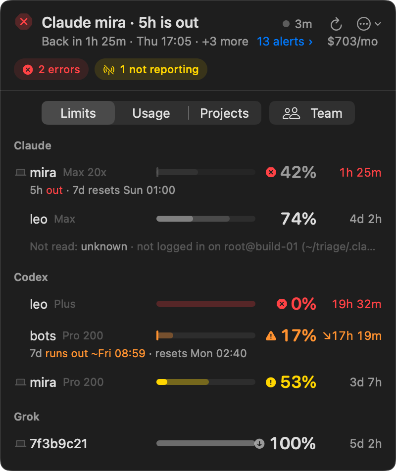</picture></td>
<td><picture><source media="(prefers-color-scheme: light)" srcset="docs/demo/app-usage-light.png">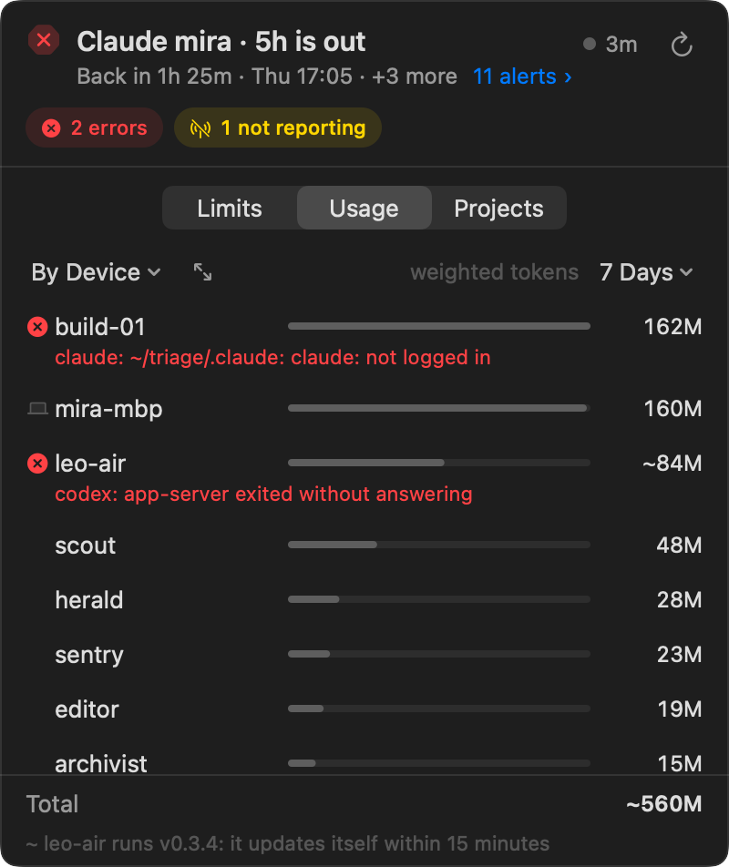</picture></td>
<td><picture><source media="(prefers-color-scheme: light)" srcset="docs/demo/app-projects-light.png">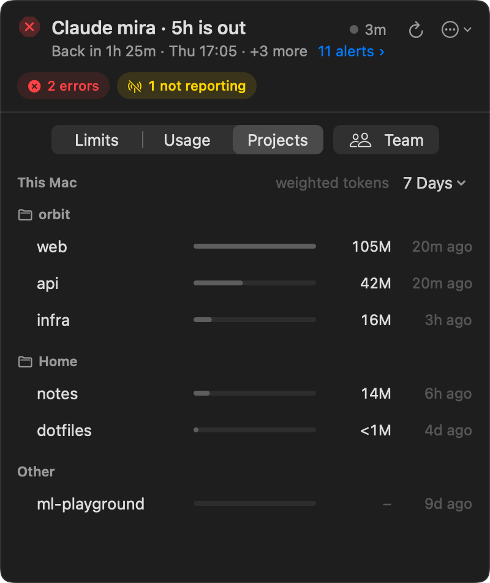</picture></td>
</tr>
</table>

- **Limits:** a row per account: a bar of what is left, with the forecast's part faint, the percent left, and the time until the reset. A row that runs out counts down to when it does instead, "↘17h 19m" in orange, or says "↘ ran out" when an old reading has and the team spent on it since, and names the window and its reset under it. When nobody has, the row counts down to its reset, and the line under it says the window "would run out ~Tue 05:18". When another window stops the account, such as a 5-hour window that is out, the row says so under it.
- **Usage:** the tokens of each device or each subscription, today or over 7, 30, or 90 days, in whole millions. A device with nothing wrong whose sessions go through BB's Account Pooler says so under its row, since its tokens may count for another account than the one that served them.
- **Projects:** this Mac's repositories, their worktrees counted in, grouped by the folder they share.

A click on a row opens its details: each window with its forecast, and the forecast of the one that runs out with the pace it takes, or where it was headed when nobody spent on it since; who spent the window since it began, "root@build-01 84M, hermes@scout 35M, +8 more · since 21 Sep 02:40", the busiest first and the rest as a count; when the subscription was last used; how old its reading is and which device took it, when the reading is old or another device's; and why the report calls it idle or could not read it, which a click on the line of the subscriptions not read also gives whole; its cost, "$238/mo typed · used ?" when no week of its Used is known, or "$200/mo · used 46% · next charge Sun 27 Sep", with `idle 9d`, `still paid?`, or `ended` when it is so; a device's release, tools, and errors, in the words of the report's NOTE; a project's sessions. Color means a problem only: red is out, orange runs out before the reset, yellow is tight. `⌘1` to `⌘3` switch the tabs and `⌘R` collects now.

<table>
<tr>
<td><picture><source media="(prefers-color-scheme: light)" srcset="docs/demo/app-alerts-light.png">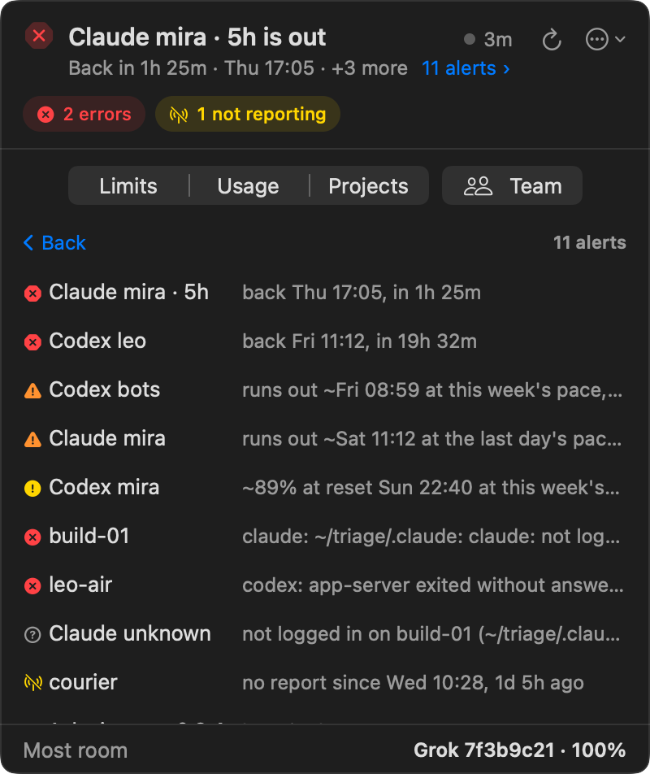</picture></td>
<td><picture><source media="(prefers-color-scheme: light)" srcset="docs/demo/app-details-light.png">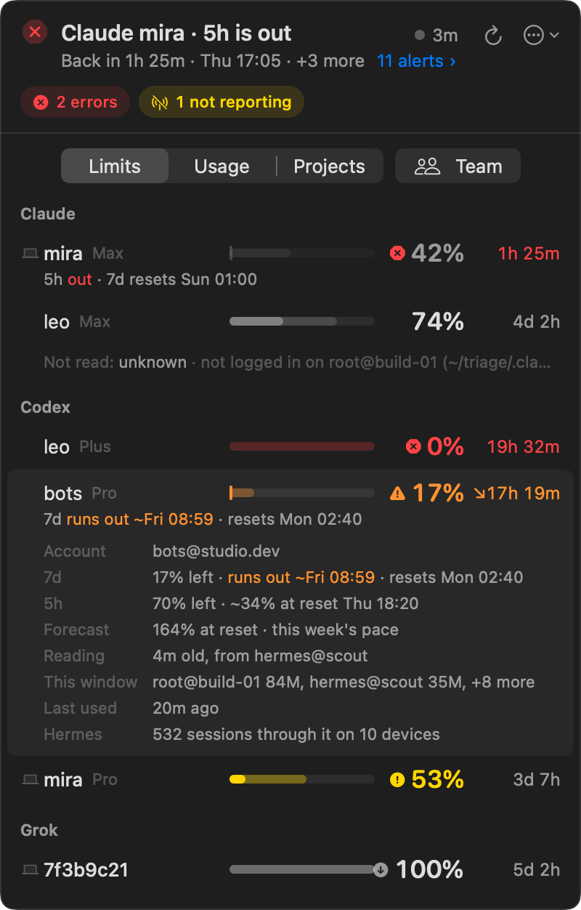</picture></td>
</tr>
</table>

**The menu**, under ⋯ or a click on the dot, has the collector's status, a colored dot for each part, and this Mac; then Collect Now, an update when there is one, and Team Window…; the report, the device status view, and every project in Terminal; and Settings and Quit. Each part is under a header, each action has its symbol, and the shortcuts, `⌘R`, `⌘D`, `⌘,`, and `⌘Q`, also work while the popover is open. A chip about the collector opens it with the chip's messages first, under Attention.

<picture>
  <source media="(prefers-color-scheme: light)" srcset="docs/demo/app-menu-light.png">
  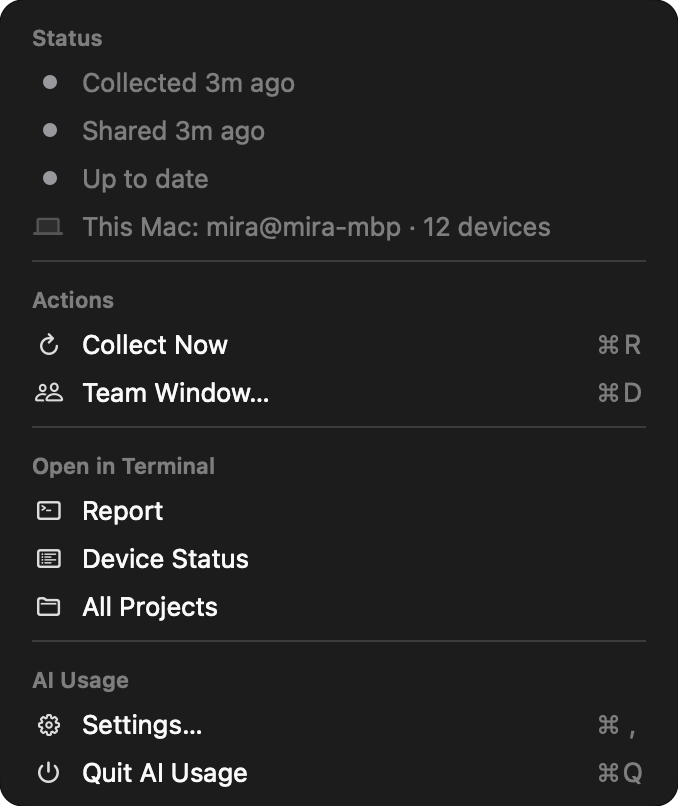
</picture>

**The Team window** has the whole team on one screen, as the terminal's DEVICES does. The Team button beside the popover's tabs opens it, and so do `⌘D` and Team Window… in the menu; with only this Mac there is no team, so none of them shows. Usage puts each device against each subscription, grouped by tool, then the tokens no subscription covers and TOTAL. A cell is shaded by its tokens, a step for every half of a tenfold below the largest, as in the terminal, and its tooltip says "root@build-01 · Codex bots: 131M in 7 Days · 46% of column · 84M this window"; a subscription's name is in the color of its state. Status has each device's release (↓ when it is behind the latest), last report, the tools it reads (× for a failing one), its tokens in each period, and the report's NOTE. A click on a heading sorts the rows; until then they are in the report's order. Cost puts each device against each subscription that has not ended in dollars over the last 4 weeks, with Unused and Total rows under them, so every column adds up to the subscription's price, and the team's total a month in its header. As in the terminal, `1`, `7`, `3`, and `9` pick the period, `%` switches Usage between tokens and each device's share of its column, `s` switches between Usage and Status, and `$` to Cost and back. The window opens where it was last, at its size.

<picture>
  <source media="(prefers-color-scheme: light)" srcset="docs/demo/app-team-light.png">
  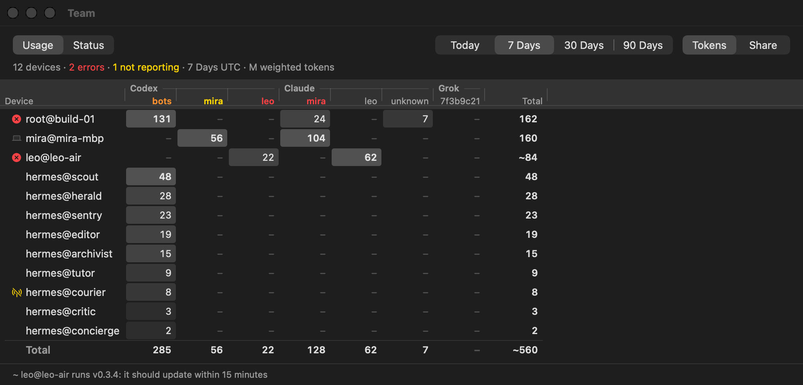
</picture>

<picture>
  <source media="(prefers-color-scheme: light)" srcset="docs/demo/app-team-status-light.png">
  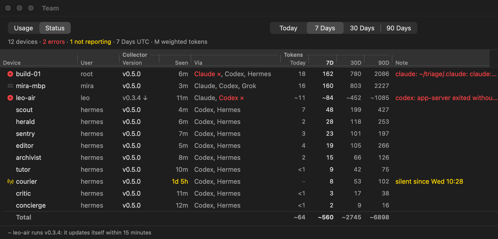
</picture>

<picture>
  <source media="(prefers-color-scheme: light)" srcset="docs/demo/app-team-cost-light.png">
  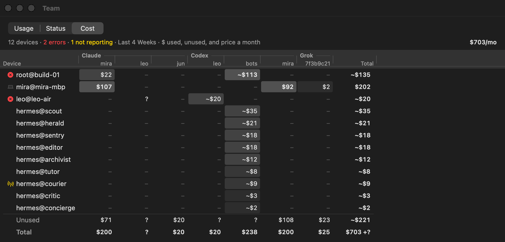
</picture>

**Notifications** say when a window is out, "Claude mira · 5h is out", with when it is back, and when one will run out before its reset, "Claude mira · 7d runs out ~Sat 11:12", with how long before its reset. A window whose run-out time passed with nobody on the team spending on it since gets none. They are the windows the report's ATTENTION marks out and over, and Settings picks which: When a Window Is Out (on by default); When a Window Will Run Out, Within a Day (the default), Any Time, or Never, since a forecast early in a long window can say it runs out days ahead and change by the next reading; and Subscriptions, This Mac's (the default), those logged in here, or The Team's, every subscription with a reading, bots' included, where a notification also names the device that uses it most, "used on root@build-01 +9". Each window gets one notification per period and state, not one at every run: a forecast that dips under 100% and rises again says nothing new, and after its reset a window starts over. The app remembers what it said in its settings, so a restart says nothing twice. A click on a notification opens the popover on that subscription in Limits, when the menu bar has room to show the app's item. macOS asks for permission when there is first something to say, or when you turn a notification on; when you decline, the app asks no more, and Settings says where to turn notifications on.

The cost has three notifications of its own, each on by default and for the same subscriptions: a change, such as a new subscription, a change of plan or of a list price, or one that ended; a charge in 3 days, with how much of the subscription was used; and the [questions](#cost) the report asks on this Mac. Whether a subscription is still paid has the actions Still Paying, Cancelled, and Skip; a charge day or a price has a field to type it in and Skip, and a charge day also Use the Suggested Day when the report has one. An answer runs `ai-usage cost`, and when it refuses the answer, a notification says why. Each is said once, a change or a charge only within 3 days of it, so the first run of a new release does not tell a month of news. A click opens Settings on Cost.

**Settings** does what the terminal commands do: this Mac's name in the team (`ai-usage name`), the names of accounts (`ai-usage alias`), the relay (`ai-usage relay`), the team key, open at login, Share Usage Stats (`ai-usage telemetry`), what the menu bar shows and whose subscriptions it tracks, notifications, updates, and the cost (`ai-usage cost`). Cost has this Mac's questions on top, then each subscription with its plan, who bills it, Used, next charge, and state; a click on one opens its price, Billed (Monthly or Yearly), Next Charge, Still Paying, Cancelled, and Reset; and under them the cost's notifications. About names the app and its version once, beside Check for Updates, which runs `ai-usage update` and so updates the app too, and says where the command-line tool is, "Command-Line Tool (Homebrew)" when the report says Homebrew installed it. It names the tool's release only when it is another one, "Command-line tool v0.5.1: updates with Check for Updates", or "Command-line tool v0.5.1 (Homebrew): updates with Check for Updates or brew upgrade", or says the tool is not found. Under Homebrew, Check for Updates runs `ai-usage update`, which runs `brew upgrade neoromantic/tap/ai-usage` and brings the app to the release brew installed; it waits up to 15 minutes for it. When it fails, the app shows ai-usage's own error, not what brew printed before it.

<picture>
  <source media="(prefers-color-scheme: light)" srcset="docs/demo/app-settings-light.png">
  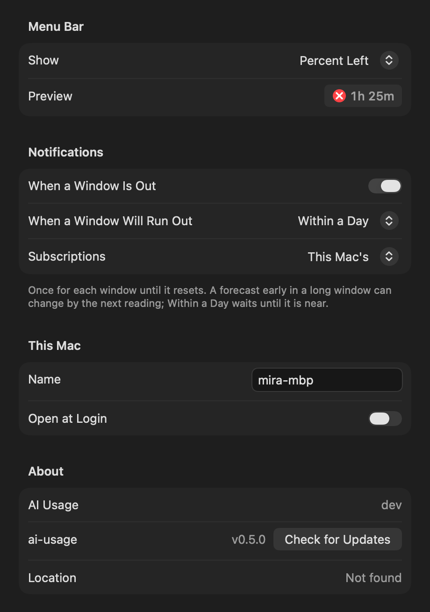
</picture>

<picture>
  <source media="(prefers-color-scheme: light)" srcset="docs/demo/app-settings-cost-light.png">
  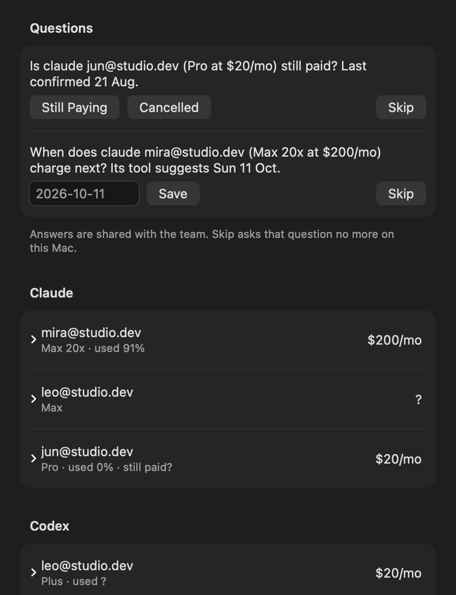
</picture>

The app computes nothing itself. It runs `ai-usage report --json` every minute and when the popover opens, and shows what the report says: forecasts, states, what needs attention, the cost, and the collector's health. It keeps no answer of its own either: each one runs `ai-usage cost`. Its notifications come from the same report. The tooltip of a release that is out takes its words from the report too: "ai-usage v0.5.0 installs v0.5.1 on its next check" for a script install, and "v0.5.1 is out; Update runs brew upgrade neoromantic/tap/ai-usage" for a Homebrew one. It finds the binary through the launch agent, or shows the install command when there is none, with the Homebrew one under it. Its runs of `ai-usage` record no [usage stats](#usage-stats); it records only that it started and that its popover, Team window, or Settings opened, and until you have seen the notice, which the popover shows once with OK and Turn Off, not even that. To go without it, install with `AI_USAGE_NO_APP=1`, or remove it as [Uninstall](#uninstall) shows; neither self-update nor `brew upgrade` brings it back, and `ai-usage app install` does.

## In BB

AI Usage is also a plugin for [BB](https://getbb.app): the team report on a page of its own, with the same attention, subscriptions, forecasts, cost and its questions, devices × subscriptions, and devices as the console, and a Team usage card in the sidebar's footer. It shows `ai-usage report --json` as ai-usage words it, as the menu bar app does.

```sh
bb plugin install npm:@goodit/bb-plugin-ai-usage
```

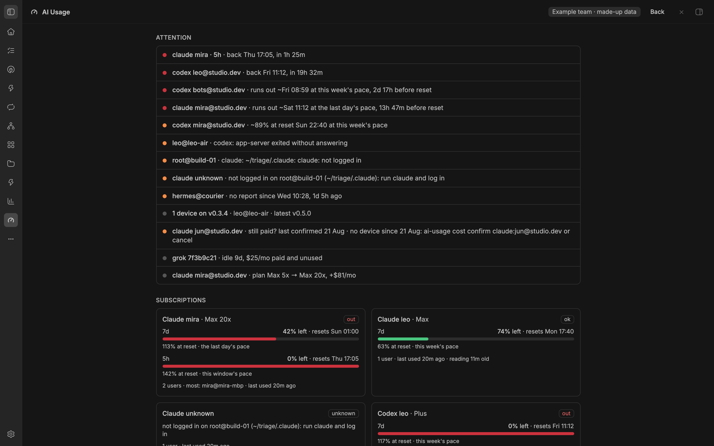

When the plugin starts on a Mac or Linux machine that runs BB as a person, not root, and has no ai-usage, it installs ai-usage there once, with the install.sh of the latest release, the menu bar app and shell profiles left out. A machine that already has ai-usage, from the installer or Homebrew, is used as it is. Otherwise the page offers Install, with a team key a colleague sent, and an example team of made-up data. Settings → AI Usage says which ai-usage the plugin reads, and has Update, Pause collecting, Install menu bar app, Remove ai-usage, and the other BB machines, each with an Install that joins it to the same team. Invite copies a message with the team key; Join pastes one. The palette has AI Usage: Open and AI Usage: Refresh.

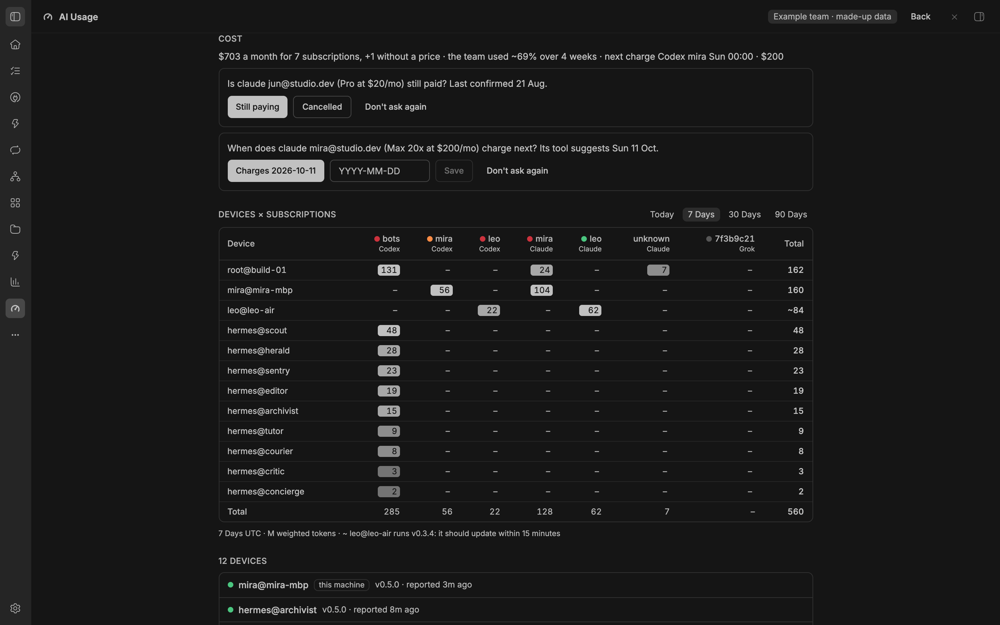

What to know before you install it:

- ai-usage runs from the scheduler every 15 minutes, with BB open or not, and updates itself from GitHub Releases. Removing the plugin leaves it collecting: Remove ai-usage in Settings, or [Uninstall](#uninstall), takes it off.
- The relay sees what [Privacy](#privacy) says, whether ai-usage came from BB or not. The plugin's own runs of ai-usage send no [usage stats](#usage-stats), and its install shows nobody their notice, so the scheduler's runs send none until someone has seen it in a terminal or in the menu bar app.
- BB's Cursor, OpenCode and Pi agents are not counted. Sessions BB's Account Pooler routes count for the login of the folder that holds their logs, and their machine is marked; see `pooled` in [docs/json-schema.md](docs/json-schema.md).
- Anything that runs in BB as you, agents included, can read the team report through the plugin and ask it for the team key, as it can read ai-usage's own files. The plugin answers no other plugin, keeps no copy of the key, and logs neither the key nor the report.
- It sends no notifications; the menu bar app does.

## Install

macOS and Linux:

```sh
curl -fsSL https://raw.githubusercontent.com/neoromantic/ai-usage/main/install.sh | sh
```

Windows, in PowerShell:

```powershell
irm https://raw.githubusercontent.com/neoromantic/ai-usage/main/install.ps1 | iex
```

Or with [Homebrew](#homebrew) on macOS and Linux, from v0.8.0.

Releases are built for amd64 and arm64 on each OS, and the menu bar app is one build for Apple silicon and Intel Macs. The installer:

1. downloads the release file for your OS and CPU, and `checksums.txt` from the same release, and on macOS 14 and later the [menu bar app](#menu-bar-app) from that release too
2. checks the SHA-256 checksums
3. installs the binary into a folder on your `PATH` (see below), or to `%LOCALAPPDATA%\Programs\ai-usage\ai-usage.exe` on Windows, where it also adds that folder to your user `PATH`
4. saves the relay and joins the team, if you gave them
5. prints the [usage stats](#usage-stats) notice, when you or an AI agent can read it
6. runs `ai-usage` once, which registers it with the scheduler and prints the report with a short guide under it
7. on macOS 14 and later, puts the menu bar app in `~/Applications/AI Usage.app` in place of an earlier copy, quits the copy that runs, and opens the new one; with no one logged in at the screen, as over SSH, it says to open the app there once instead

On macOS and Linux, an upgrade replaces the binary where it is: `~/.local/bin/ai-usage`, or the `ai-usage` found on `PATH` when you can write to its folder. A new install goes into the first of `~/.local/bin` and `~/bin` that is on your `PATH` and that you can write to, and never into a folder that belongs to another tool, such as `~/.cargo/bin` or Homebrew's `/opt/homebrew/bin` and `/usr/local/bin`.

When none of them is, the binary goes into `~/.local/bin`, and the installer adds that folder to `PATH` in the profile of your login shell, the one `$SHELL` names:

| Shell | Profile |
| --- | --- |
| zsh | `~/.zshrc`, or `$ZDOTDIR/.zshrc` |
| bash on macOS | the first of `~/.bash_profile`, `~/.bash_login`, and `~/.profile` that exists, else a new `~/.bash_profile`; a terminal on macOS opens a login shell, which reads only that one |
| bash on Linux | `~/.bashrc` |
| fish | `~/.config/fish/conf.d/ai-usage.fish`, or the same under `$XDG_CONFIG_HOME` |
| sh, dash, ash, ksh, or mksh | `~/.profile` |
| another shell, such as tcsh or nushell | none; the installer prints the line to add |

It adds a block that starts with `# Added by the ai-usage installer`, once: running the installer again adds nothing. A new terminal finds `ai-usage` by name; in the terminal you installed from, use the full path the installer prints. With `AI_USAGE_NO_MODIFY_PATH=1`, and as root under `sudo`, where `HOME` can still be yours, it leaves profiles alone and prints the line to add.

The installer replaces only its own binary. Another program named `ai-usage`, or a link such as a version manager's shim, stays where it is, and the installer picks a folder as it would for a new install. When the only folder left holds one, it stops; set `AI_USAGE_BIN_DIR` then. When another `ai-usage` still comes first on your `PATH`, such as an older copy in a folder you cannot write to, the installer says so, because typing `ai-usage` runs that one.

When Homebrew installed ai-usage for you, which the installer tells by an `opt/ai-usage` you own under `$HOMEBREW_PREFIX`, `/opt/homebrew`, `/usr/local`, or `/home/linuxbrew/.linuxbrew`, it stops before it downloads anything. Another user's Homebrew copy, in a prefix you share, does not stop it:

```
ai-usage install: ai-usage is installed with Homebrew (/opt/homebrew/bin/ai-usage); update it with
`brew upgrade neoromantic/tap/ai-usage`. To use this installer instead,
run `brew uninstall neoromantic/tap/ai-usage` first; the state folder and team key stay.
```

With `AI_USAGE_BIN_DIR` set it installs a second copy anyway, which leaves the schedule to Homebrew's; see [Two copies](#two-copies).

The installer asks no questions. Run it again to upgrade in place. It reads these variables:

| Variable | Meaning |
| --- | --- |
| `AI_USAGE_BIN_DIR` | where the binary goes, instead of the folder the installer picks; it edits no profile then |
| `AI_USAGE_NO_MODIFY_PATH` | leave shell profiles alone |
| `AI_USAGE_NAME` | this machine's name in the team, instead of its host name |
| `AI_USAGE_RELAY` | relay URL to save before the first run |
| `AI_USAGE_TEAM_KEY` | team key to join before the first run |
| `AI_USAGE_DOWNLOAD_URL` | where to download release files from, instead of the latest GitHub release |
| `AI_USAGE_ALLOW_ROOT` | install for root even though the installer runs under `sudo` |
| `AI_USAGE_NO_APP` | leave out the menu bar app on macOS |

To join a team while installing, which is how a teammate's machine joins yours (`ai-usage team key` prints the key and `ai-usage relay show` the relay):

```sh
curl -fsSL https://raw.githubusercontent.com/neoromantic/ai-usage/main/install.sh |
  AI_USAGE_RELAY=https://relay.example.com AI_USAGE_TEAM_KEY='aiu-team-1:…' sh
```

```powershell
$env:AI_USAGE_RELAY = 'https://relay.example.com'
$env:AI_USAGE_TEAM_KEY = 'aiu-team-1:…'
irm https://raw.githubusercontent.com/neoromantic/ai-usage/main/install.ps1 | iex
```

A key typed on the command line stays in your shell history. To avoid that, install first, then run `ai-usage team join` and paste the key.

Run the installer as the person whose usage you want to collect. Under `sudo` it stops, because the collector would register root's schedule and read root's tools, and could leave root-owned files in your home. On a server whose bots run as root, install it as root itself, with `AI_USAGE_ALLOW_ROOT=1` if you got there through `sudo`. For a container, see [In a container](#in-a-container).

On Linux the schedule needs `crontab`, which containers and some minimal systems lack; `ai-usage schedule run` takes its place there. The installer needs `curl` or `wget`, and `sha256sum`, `shasum`, or `openssl`.

The menu bar app is for the person at the screen, so root never gets it. When it cannot be installed, for example on macOS 13, the installer says why and the rest of the install stands.

### Homebrew

From v0.8.0, on macOS and Linux:

```sh
brew install neoromantic/tap/ai-usage
ai-usage team join          # optional: paste a teammate's key, to join their team
ai-usage relay set URL      # optional: your own relay
ai-usage name set NAME      # optional: this machine's name in the team
ai-usage                    # collect, register with launchd or cron, and print the report
ai-usage app install        # on macOS 14 and later: the menu bar app
```

Homebrew installs the binary and nothing else: it runs no command of ai-usage's, so the first `ai-usage` registers the schedule, as the installer's first run does, and shows the [usage stats](#usage-stats) notice, and `ai-usage app install` adds the menu bar app. `brew info neoromantic/tap/ai-usage` repeats the notice, and the formula's test sends nothing. If you ran `ai-usage schedule remove` before, run `ai-usage schedule install` instead of the bare `ai-usage`, since runs leave a removed schedule removed. Homebrew is per-user: run these as the person whose usage you want to collect, not with `sudo`.

The binary is static and needs nothing from Homebrew. On a Linux whose glibc is older than 2.39, such as Ubuntu 22.04 or Debian 12, Homebrew gives every formula its own glibc and gcc, about 650 MB; from v0.8.1 the formula of ai-usage leaves them out. If v0.8.0 brought them, `brew autoremove` removes them after `brew upgrade neoromantic/tap/ai-usage`, unless another formula needs them.

Type the full name, `neoromantic/tap/ai-usage`, in every brew command. Homebrew trusts a formula from a tap outside its own by that name, and refreshes the tap before an upgrade only when it is named. If you added the tap first with `brew tap neoromantic/tap` and Homebrew asks you to trust it, `brew trust neoromantic/tap` does.

The schedule names Homebrew's stable path, such as `/opt/homebrew/opt/ai-usage/bin/ai-usage`, which brew moves to each new release, so upgrades never touch the launch agent or the crontab line. A copy Homebrew installed never replaces itself; see [Updates](#updates).

`ai-usage app install` puts the menu bar app of the binary's release in `~/Applications/AI Usage.app`, as the installer does, whatever installed ai-usage. It needs macOS 14 or later, refuses root and builds from source, quits a copy that runs, and opens the new one; with no one logged in at the screen, it says to open the app there once. Runs keep the app at the binary's release from then on. It says `run ai-usage first, so the app finds a report` when nothing has been collected yet, and installs the app anyway.

### Two copies

Homebrew's copy and one the installer put in `~/.local/bin` or `~/bin` would take turns registering with the scheduler, so the scheduler runs only Homebrew's. The installer's copy, from v0.8.0, registers Homebrew's copy in its place, as does `ai-usage schedule install` run from it, and leaves updates to Homebrew's. `ai-usage status` then says `Homebrew's ai-usage at /opt/homebrew/bin/ai-usage runs the schedule; remove this copy: rm /Users/ann/.local/bin/ai-usage`. Homebrew's copy says `another ai-usage at /Users/ann/.local/bin/ai-usage also runs; remove it: rm /Users/ann/.local/bin/ai-usage`. An installer copy before v0.8.0 updates itself to the latest release within 15 minutes, and hands over from then on. Both copies share the state folder, the team key, and the history. On macOS, when a scheduled run hands over, launchd runs the installer's copy until the agent is loaded again, and `ai-usage status` says to run `ai-usage schedule install` first; see [launchd runs an old copy](#launchd-runs-an-old-copy).

An installer before v0.8.0 could put its copy in `/opt/homebrew/bin` or `/usr/local/bin`, where brew then cannot link its own, and `brew install` says so. Both copies then say to run `brew link --overwrite neoromantic/tap/ai-usage`, which puts Homebrew's link in place of the installer's copy.

Only your own Homebrew copy counts. Another user's, in a prefix you share, as root sees an admin's `/home/linuxbrew/.linuxbrew`, runs only that user's schedule, so your copy registers and updates itself as before.

### Switch between the installer and Homebrew

From the installer to Homebrew: remove the installer's copy, `rm ~/.local/bin/ai-usage`, or the path `which -a ai-usage` shows, and the block in your shell profile that starts with `# Added by the ai-usage installer`; then `brew install neoromantic/tap/ai-usage`, and run `ai-usage`. The state folder and the team key stay, so the machine stays the same device in the team.

From Homebrew to the installer: `brew uninstall neoromantic/tap/ai-usage`, then run the installer again. Its first run registers the installer's copy in place of Homebrew's.

## First run

The first run:

- creates the state folder
- generates a new team key, unless the installer joined a team, so an install starts as a team of one
- registers with the scheduler: a line in your crontab on Linux, a launch agent on macOS, a task named `ai-usage` in Task Scheduler on Windows
- collects and prints the report
- prints a short guide under the report: which scheduler now collects every 15 minutes, or what to do when none could be registered; what the team and the relay see; what a weighted token weighs; when it applies, that the team's tables count UTC days, and today from your local midnight, that the ledger holds less than 90 days of Claude, or why the team's totals are estimated; and the commands worth knowing, with how to invite a colleague, `ai-usage app install` on a Mac with macOS 14 or later that does not have the menu bar app, how to pause the system scheduler's runs, and how to uninstall
- on a terminal or for an AI agent, prints the [usage stats](#usage-stats) notice once, on standard error, unless the installer or the menu bar app showed it before
- on a terminal, asks the [cost](#cost) questions after the guide, one per line: when each subscription logged in here charges, its price when the list has none, and whether one nobody can confirm is still paid. An empty line takes the suggestion, or leaves the question for later; `s` skips it for good, and `S` asks nothing more

The guide is printed once. When the scheduler collected first, or the first run you started used `--json`, the guide comes with the next `ai-usage` that prints text; `ai-usage report` never prints it.

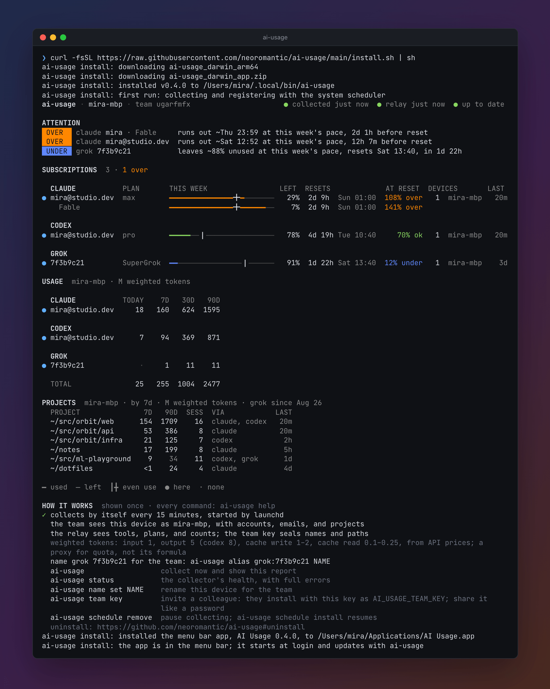

The crontab line looks like this. It keeps the `PATH` of the shell that installed it, so that scheduled runs find the tools, and it names the state folder, so that scheduled runs use the same device, team key, and history as your own runs:

```
*/15 * * * * PATH='/home/ann/.local/bin:/usr/bin:/bin' '/home/ann/.local/bin/ai-usage' collect --quiet --home '/home/ann/.config/ai-usage' >/dev/null 2>&1 # ai-usage
```

On macOS the same command and `PATH` go into `~/Library/LaunchAgents/io.github.neoromantic.ai-usage.plist`, which launchd runs at every quarter hour in your login session, where the collector can read the keychain. Registering it needs no prompt, though macOS may show a notification that ai-usage added a background item. If the Mac missed runs while asleep, launchd runs it once on wake. With no one logged in at the screen, as over SSH before the first login, there is no session to register in, and `ai-usage status` says so.

The Windows task runs `ai-usage.exe collect --quiet --home <state folder>` every 15 minutes through `conhost.exe --headless`, without opening a console window. Unlike Task Scheduler's defaults, it also runs on battery, runs once after the computer wakes if it missed a run, never runs twice at once, and is stopped after 10 minutes. Check `ai-usage status` for collection errors: Task Scheduler reports the launcher's exit code. Scheduler failures are reported on localized Windows too, instead of being treated as a missing task.

A scheduled run, `collect --quiet`, first waits up to a minute, the same for a machine every time, so that a team's machines do not all reach the relay at the quarter hour. It sends this machine's snapshot every time and reads the team when its last read is 20 minutes old, every other run.

To pause the collector, comment out the crontab line, disable the task in Task Scheduler, or on macOS run:

```
launchctl disable gui/$(id -u)/io.github.neoromantic.ai-usage
launchctl bootout gui/$(id -u)/io.github.neoromantic.ai-usage
```

Runs leave it that way, and `ai-usage status` says it was disabled by hand. `ai-usage schedule install` turns it back on.

The state folder is `~/Library/Application Support/ai-usage` on macOS, `$XDG_CONFIG_HOME/ai-usage` or `~/.config/ai-usage` on Linux, and `%LOCALAPPDATA%\ai-usage` on Windows (not the roaming profile, so the device id stays on this machine). `AI_USAGE_HOME` moves it. The scheduler entry follows the folder of the last run that registered it, so after moving the folder, run `ai-usage` once with the new `AI_USAGE_HOME`. It holds:

| File | Contents |
| --- | --- |
| `config.json` | this device's id, the relay, remembered and added homes, the `CLAUDE_CONFIG_DIR` value seen for them, which login each added Hermes home bills through, whether the schedule is off |
| `team.key` | the team's private key; this is the secret |
| `team.key.previous` | the key from before the last `team join` to another team; also a secret |
| `state.json` | the last good readings, sessions, and health, and whether the guide is still to be printed; one a later release saved is left as it is, and the run says to update |
| `state.json.last` | a copy of the `state.json` this release last saved; a run whose `state.json` does not parse starts again from it |
| `state.json.bad` | a `state.json` that did not parse, kept when a run started again from `state.json.last`, or from an empty state when that did not parse either |
| `state.json.pre-v0.4` | the `state.json` a release before v0.4.0 saved, kept once for going back to it |
| `projects.json` | the project each folder belonged to, so a worktree that is gone still counts with its repository |
| `cost.json` | the team's subscriptions as this device found them, with each one's plans, the prices, cadences, and charge days people typed, and the questions skipped and news already told; one a later release saved is left as it is |
| `prices.json` | the relay's price list, as last fetched, and when |
| `cache/` | what the last run parsed of each Claude Code transcript, so the next one reads only what was added |
| `team-cache.json` | the team's snapshots from the last read |
| `samples/` | one file per day of samples, kept for 90 days; UTILIZATION finds each window's periods in them |
| `run.lock`, `config.lock`, `schedule.lock` | keep two runs from overlapping, two commands from changing `config.json` at once, and tell other runs that `schedule run` schedules this folder; held with the system's file lock, which ends with its process |

## Teams

A team is one key pair. Every machine in the team stores the same private key. The team's name is the fingerprint of its public key, like `472ghuwcctyu…`, which is not secret.

To add a machine to your team:

1. On a machine in the team, run `ai-usage team key`. It prints the private key, `aiu-team-1:…`. Anyone who has it can read the team's snapshots and publish into the team, so share it the way you would share a password.
2. On the new machine, install with `AI_USAGE_TEAM_KEY` as shown above, or run `ai-usage team join` and paste the key, as after a Homebrew install.
3. Make sure both machines use the same relay: `ai-usage relay show`.

Joining saves the previous key as `team.key.previous`, drops the cached team, and asks the relay, if one is set, to remove this machine from the old team. `ai-usage team` lists the team's machines. `ai-usage team forget-device ID` removes a retired machine's snapshot from the relay and from this machine's team view; ID can be the start of the id, at least the 8 characters that ATTENTION shows for a reinstalled machine's old record, as `3f9a1c2e`. A snapshot that is not updated expires on its own: after 90 days, or sooner for a machine that has reported for less time than that, but never sooner than 7 days after its last update.

A key cannot be revoked. To shut someone out, start a new team and join the remaining machines to it: on one machine, move `team.key` out of the state folder, run `ai-usage` to generate a new key, and give that key to the others.

In the team view, token counts add up across machines. Quota percentages do not: an account's quota is the newest reading any machine has for it.

While any machine in the team runs a release before v0.4.0, every machine sends the snapshot such a release reads, without weighted tokens, so that none drops out of its view. The team's weighted tokens are then estimated from input and output, marked `~`, and the legend names the machines holding them back and what to do: releases from v0.2.5 on should update within 15 minutes, and one that has not, as when its update fails or Homebrew installed it, takes `ai-usage update` on it; older ones need `install.sh` again. A retired machine on an old release, or one silent for over a week, holds them back until `ai-usage team forget-device` forgets it.

Likewise, while any machine runs a release before v0.5.0, no machine sends the periods UTILIZATION shows, since such a release cannot read them: each machine shows its own, and a line under the section's title names the machines holding them back and what to do. A relay that does not accept them yet, because it runs an older release, has each machine send its snapshot without them and try again a day later.

The same holds for what people type with [`ai-usage cost`](#cost), from v0.10.0: while any machine runs an older release, each answer counts only on the machine it was typed on. A relay before v0.10.0 neither keeps the answers nor serves a price list, so every machine uses the list built into its release.

From v0.10.2 a machine that keeps reporting on an older release for 3 days after a newer one came out no longer holds any of these back: the others send what the newer release added, and that machine, which cannot read such snapshots, sees only itself until it updates. Its NOTE and OLD say how long it has not updated. A machine that stopped reporting, such as a laptop asleep while a release came out, still holds them back until it wakes, updates, or is forgotten with `ai-usage team forget-device`.

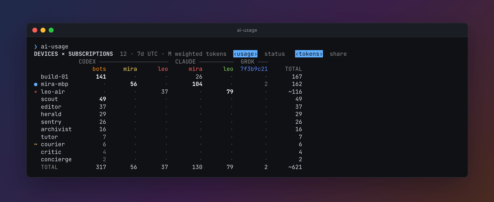

A machine goes by its host name; a Mac goes by the local host name in Sharing settings, which does not change with the network. `ai-usage name set NAME` gives it another, and the team sees it after the machine's next run. The report names each machine by the OS user ai-usage runs as, at that name: `ann@mira-mbp`, `root@build-01`. A person and their machine are one consumer, and each user or bot on a shared server reads as one of its own. A name that has an `@` in it already stays as it is.

An account goes by a short name in the report: the part of an email before the `@`, or the first 8 characters of an id. To give one a name of your choosing for the whole team:

```sh
ai-usage alias                                  # the names the team gave accounts
ai-usage alias ann@example.com ann              # name an account
ai-usage alias codex:ann@example.com ann-cx     # name it on one tool only
ai-usage alias ann --clear                      # go back to the default name
```

The account is its label, its current name, or `PROVIDER:LABEL`; an email matches in any case. The same label on several tools is one person, so a name without a provider goes to each of them. A name is at most 12 columns wide, with no spaces. It travels sealed in this machine's snapshot, so the team sees it after this machine's next run, and the newest name any machine set for an account wins.

## Relay

The relay is a small HTTP API that keeps one snapshot per machine. It is needed only for the team view; without one, ai-usage reports on this machine alone.

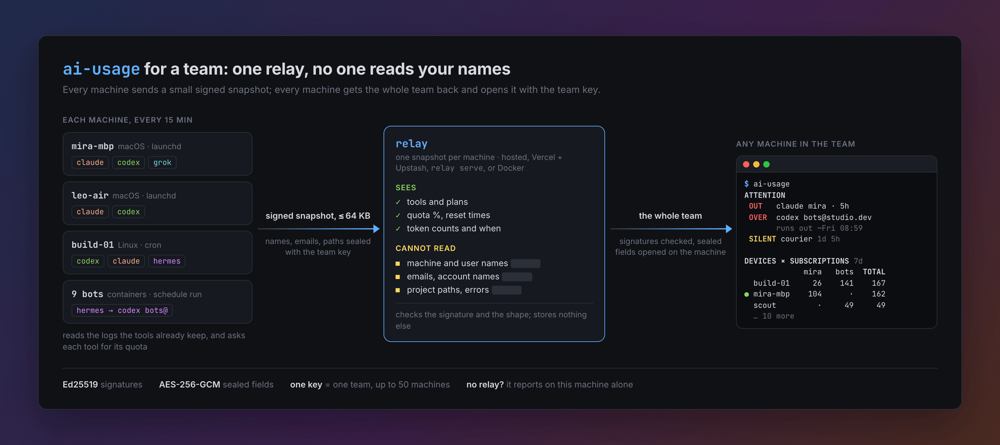

```sh
ai-usage relay show                          # the relay in use, or "no relay configured"
ai-usage relay set https://relay.example.com
ai-usage relay clear
```

A release build may carry a default relay, chosen when the release was built. `relay set` overrides it and `relay clear` goes back to it. `AI_USAGE_RELAY` overrides both for one run.

The relay accepts only a small, fixed-shape usage snapshot signed by the team key. It checks the signature and the shape and stores nothing else. It limits requests per IP address, writes per team, and machines per team (50). Each IP address can also add only 5 new teams and 100 new machines a day.

To run your own relay on Vercel with Upstash for Redis (formerly Vercel KV), use the button, which copies this repository into your Git account and deploys it with a new database:

[](https://vercel.com/new/clone?repository-url=https%3A%2F%2Fgithub.com%2Fneoromantic%2Fai-usage&project-name=ai-usage-relay&repository-name=ai-usage-relay&stores=%5B%7B%22type%22%3A%22integration%22%2C%22integrationSlug%22%3A%22upstash%22%2C%22productSlug%22%3A%22upstash-kv%22%2C%22protocol%22%3A%22storage%22%7D%5D)

Or, from a clone with the Vercel CLI logged in, run `sh scripts/deploy-relay.sh`. On any other machine, `ai-usage relay serve` runs the same relay, and so does the official Go image in Docker. Then point every machine in the team at it with `ai-usage relay set URL`. [docs/relay.md](docs/relay.md) covers each way, the limits, and updates; [docs/relay-protocol.md](docs/relay-protocol.md) specifies the protocol for other clients and relays.

## Commands

| Command | What it does |
| --- | --- |
| `ai-usage [--json] [--offline] [VIEW] [DISPLAY]` | collect now and print the report; `--offline` skips the relay |
| `ai-usage collect [--quiet] [--json] [--offline] [--home DIR] [VIEW] [DISPLAY]` | the same; the scheduler runs `collect --quiet --home DIR`, and `--home` overrides `AI_USAGE_HOME` |
| `ai-usage report [--json] [VIEW] [DISPLAY]` | print the last collected report without collecting |
| `ai-usage report --from FILE [VIEW] [DISPLAY]` | show a report saved with `--json`, such as one in [docs/demo](docs/demo), instead of this machine's; it reads no state and collects nothing |
| `ai-usage status [--json] [DISPLAY]` | version, last success, last error, relay, schedule, update, and each tool's state, with full error texts; before the first run, how ai-usage is installed and what the scheduler runs, creating nothing |
| `ai-usage team` | the team fingerprint and its machines |
| `ai-usage team key` | print the team's private key |
| `ai-usage team join [KEY]` | join a team; the key is read from standard input when omitted |
| `ai-usage team forget-device ID` | remove a retired machine's snapshot from the relay and from this machine's team view; `ID` may be the start of the id, at least 8 characters |
| `ai-usage home` | list every data folder this machine reads, per tool |
| `ai-usage home add PROVIDER DIR... [--quota-from PROVIDER:DIR]` | read more data folders; see [Other data folders](#other-data-folders) |
| `ai-usage home remove PROVIDER DIR... [--forget]` | stop reading folders added before; `--forget` also drops the sessions counted from them, for folders another collector reads now |
| `ai-usage relay show` | print the relay in use |
| `ai-usage relay set URL` | save a relay URL, `http://` or `https://` |
| `ai-usage relay clear` | forget the saved relay |
| `ai-usage relay serve [--addr :8080] [--client-ip-header NAME]` | run a relay; behind a reverse proxy, name the header it sets to the client's address |
| `ai-usage name show` | print this machine's name in the team, and the name the report shows, its OS user at it |
| `ai-usage name set NAME` | name this machine in the team, instead of its host name; at most 64 characters |
| `ai-usage name clear` | go by the host name again |
| `ai-usage alias` | list the names the team gave accounts |
| `ai-usage alias ACCOUNT NAME` | name an account for the whole team, in at most 12 columns; `ACCOUNT` is a label, a name, or `PROVIDER:LABEL` |
| `ai-usage alias ACCOUNT --clear` | go back to the account's default name |
| `ai-usage cost [--json] [DISPLAY]` | what the team's subscriptions cost a month, how much of it the team used over the last 4 weeks, and which machine used it; see [Cost](#cost) |
| `ai-usage cost set ACCOUNT [--price N] [--monthly\|--yearly] [--renews DAY]` | type what a subscription costs each charge, a year's with `--yearly`, and its next charge, DAY as `YYYY-MM-DD`, or a day of the month when it is billed monthly; a change of cadence alone turns a typed price into the new cadence's; the whole team sees it |
| `ai-usage cost confirm ACCOUNT`, `ai-usage cost cancel ACCOUNT` | say a subscription is still paid, or that it was cancelled |
| `ai-usage cost reset ACCOUNT` | clear the typed price, cadence, and charge day, so the list price counts again |
| `ai-usage cost skip ACCOUNT renewal\|price\|still_paid` | never ask this machine that question of the subscription again |
| `ai-usage cost never-ask [--undo]` | ask no cost questions on this machine |
| `ai-usage cost prices` | the price list in use, when it was checked, and where it came from |
| `ai-usage schedule install` | register with the scheduler, and let later runs keep it registered |
| `ai-usage schedule remove` | unregister, and stop later runs from registering again |
| `ai-usage schedule status` | whether the scheduler runs this binary with this state folder, or was disabled by hand; on macOS, from the job launchd has loaded, not only the plist |
| `ai-usage schedule run` | be the scheduler where there is none, as in a container: collect now and every 15 minutes until stopped |
| `ai-usage update` | check for a release now; where Homebrew installed ai-usage, run `brew upgrade neoromantic/tap/ai-usage` |
| `ai-usage app install` | add the menu bar app of this release, on macOS 14 and later, whatever installed ai-usage |
| `ai-usage uninstall [--forget] [--purge]` | remove the schedule, the menu bar app, and the binary, or say how where Homebrew installed it; keep the state folder unless `--purge`; see [Uninstall](#uninstall) |
| `ai-usage telemetry [status] [--json]` | whether [usage stats](#usage-stats) go to ai-usage's author, which setting decided, the install id, and its file |
| `ai-usage telemetry off`, `ai-usage telemetry on` | stop sending usage stats and forget the install id, or send them again |
| `ai-usage telemetry notice` | print the usage stats notice, once, on a terminal or for an AI agent, as the installers do |
| `ai-usage version` | print the version |
| `ai-usage help` | print usage |

`VIEW` flags choose what the page shows. `--projects` lists every project on this machine in PROJECTS, not only the top ones. `--devices` shows DEVICES as each machine's status, and the interactive view opens on it; `s` switches back. `status` takes neither.

`DISPLAY` flags change how the console looks. `--json` ignores them.

| Flag | Meaning |
| --- | --- |
| `--color=auto\|always\|never` | `auto`, the default, colors a terminal unless `NO_COLOR` is set or `TERM` is `dumb` |
| `--ascii` | draw with ASCII only; the default when the locale (`LC_ALL`, `LC_CTYPE`, `LANG`) is not UTF-8, except in Windows Terminal |
| `--width N` | lay out for N columns, 80 to 160; the default is the terminal's width, else `COLUMNS`, else 80 |
| `--plain` | print the report; when standard input and output are both a terminal, the default is the interactive view, which scrolls, reloads, and lists its keys under `?` |

| Variable | Meaning |
| --- | --- |
| `AI_USAGE_HOME` | the state folder |
| `AI_USAGE_RELAY` | the relay URL, overriding the saved one |
| `AI_USAGE_NAME` | this machine's name in the team, overriding the saved one in the runs that see it; launchd and cron do not pass on a shell's variables, so name a computer with `ai-usage name set` |
| `AI_USAGE_NO_SCHEDULE` | when set, this run does not register with the scheduler |
| `AI_USAGE_TELEMETRY` | `0` turns [usage stats](#usage-stats) off in the runs that see it, `1` on, and `debug` prints each event to standard error instead of sending it |
| `DO_NOT_TRACK` | `1` turns usage stats off in the runs that see it, as it does for other tools that read it |
| `CLAUDE_CONFIG_DIR`, `CODEX_HOME`, `GROK_HOME`, `HERMES_HOME` | another data folder for that tool |

## Other data folders

Each tool's default folder (`~/.claude`, `~/.codex`, `~/.grok`, `~/.hermes`) is always read, and so are the profiles inside a Hermes folder, the per-account Codex folders Orca keeps, and the Claude Code folder the Claude desktop app keeps for each agent-mode (Cowork) session. A folder named by `CLAUDE_CONFIG_DIR`, `CODEX_HOME`, `GROK_HOME`, or `HERMES_HOME` in a run you start is remembered for scheduled runs. Folders nothing names, such as bots running under other users, are added by hand:

```
ai-usage home add hermes /srv/bots/alpha/.hermes /srv/bots/beta/.hermes --quota-from codex:/srv/bots/.codex
```

Hermes keeps its own login for a Codex or Grok subscription, so the collector cannot read which account it uses. By default a Hermes folder is taken to use the account logged in to `~/.codex` or `~/.grok`. `--quota-from` names the folder whose login it uses instead, one per tool, which is then read too; it covers the profiles inside each Hermes folder. `ai-usage home` shows every folder a run reads and what each bills through, and marks one that is gone as missing. `ai-usage home remove` will not remove a folder Hermes folders take their quota from until they are removed or named another. Name a folder whose login is kept fresh, by Codex itself or by whatever refreshes it for the bots. A copy that only seeded another login store goes stale: it still says whose it is, but its quota reads fail with HTTP 401.

Each Hermes session's tokens go to the login of the folder it was read from. When Hermes folders bill one route through different logins, as bots on a shared login beside your own Hermes, the Hermes account shows the quota of the login most of its tokens in the last 90 days went through.

Accounts and quota come from the tools themselves. Codex is asked through the `codex` on `PATH`; when that one is missing or too old to answer, through the copy the ChatGPT app on macOS or OpenAI's extension for VS Code, Cursor, or Windsurf bundles. Claude Code's quota comes from its usage cache, which it updates only when it reads the usage, as its `/usage` dialog does. So for a Claude subscription whose cache is missing or at least 10 minutes old, when its folder's sessions show you used Claude Code there in the last hour and since, each run first has Claude Code read it with `claude -p /usage`, through the newest Claude Code installed: the one on `PATH`, a native install's versions, Homebrew's, npm's, the desktop app's, or the one an editor extension bundles. The reading is then at most one run older than your last use of that folder, when a run comes within the hour after it. A folder you have not used in the last hour, or not since its reading, is not asked: nothing was spent there since, and your login is not kept alive for it. Two Claude folders that share their session logs through a symlink, as Orca's Claude profiles share `~/.claude/projects`, count as used whenever those logs show use, since the logs cannot say which login ran those sessions, so each is asked, and an idle one's login is renewed too. Their sessions count for the login of the first folder, the default one when it is one of them, as sessions BB's Account Pooler serves do. Claude Code answers `/usage` itself: no model is asked and no token is spent, and the run names a model that does not exist, as a safety net. It leaves no session and runs none of your hooks, though hooks an organization manages still run. Like any Claude Code session, it renews your Claude login when that has expired, which on a folder in use your own sessions do anyway; the collector itself never reads or writes the login. A login with an API key, a Console login, or a cloud provider has no quota and is not asked. Only Claude Code 2.1.208 and later cache the usage, and from 2.1.0 on, Claude Code exits without an error whether or not it read it. So a Claude Code whose install says it is older is not run, nor is one whose settings set `CLAUDE_CODE_DISABLE_NONESSENTIAL_TRAFFIC` in their `env`, since it then cannot read the usage. When the read fails, is not made for one of those reasons, or leaves no new reading, as offline, the report shows the last reading with its age, and the tool's status is partial until the folder has been idle for an hour. The reason says why in a few words, then Claude Code's version and what cache there is, such as `claude /usage: Claude Code 2.1.150 does not cache the usage; update it to 2.1.208 or later (no cache)` or `claude /usage: no new reading: could not read the usage (Claude Code 2.1.281, cache 3h old)`, which it says when Claude Code was offline, its login lacks the profile scope, its settings turn nonessential traffic off where the collector does not look, or a Claude Code whose version is not known is older than 2.1.208, and your team sees it in the device's NOTE. Nothing else Claude Code printed is kept: not your usage, when it resets, or the skills, plugins, and MCP servers it lists. When Claude has refused a request because a window was full, and the cache is older than the refusal, the account the session belongs to shows the windows refused alone, each at 100% until it resets. That reading does not go old while the window is full. A refusal from before the run that found another account logged in to the folder is not used for that account, since it may be the earlier one's. Usage counted in a folder while its tool never answered goes to the first account it names there. Usage counted while it said nobody is logged in stays unknown. A Codex session whose log several folders hold, as Orca links each into every account's folder, goes to the account that Codex's own thread database, `state_N.sqlite`, says created it, where it says so, and otherwise to the account whose weekly window resets when the session's last rate-limit reading says, within 20 seconds and clearly nearer than any other; else it stays with its first folder. From that database the collector reads only thread ids, account ids, and times, never a title, message, or path.

The Claude desktop app's agent-mode sessions are the exception. The app keeps a folder for each under `local-agent-mode-sessions` in its data folder (`~/Library/Application Support/Claude` on macOS, `%APPDATA%\Claude` on Windows), and every run finds them there again, so they are never remembered. Nobody logs in to them, and nothing is asked about them: each session's tokens go to the account the app recorded for it, or to `unknown` when that record is missing or names none. From that record the collector takes only the account and the folders, never the session's title, first message, or system prompt. The project is the first folder you gave the session, or `Claude app` when you gave none, since its working directory is inside the app's virtual machine. These sessions have no quota of their own; when Claude Code reports a quota for the same account, that reading applies.

BB's Account Pooler, in the [BB](https://getbb.app) app, serves the Claude Code and Codex sessions BB starts from one of several accounts, through a hub on the BB server. It points each session at the hub with `ANTHROPIC_BASE_URL` and `ANTHROPIC_AUTH_TOKEN`, or `CODEX_OPENAI_BASE_URL` and `CODEX_POOL_AUTH_TOKEN`. When ai-usage runs inside such a session, as in a BB thread, the tools it asks go without the pair whose base URL is on the hub, a URL whose path holds `/api/v1/plugins/account-pool/`, so each folder's own login answers. A base URL of any other gateway, such as one you set up yourself, is kept. The sessions still write their logs to `~/.claude` and `~/.codex`, and their tokens count for the login of that folder, which may not be the account that served them: Claude Code's logs do not say the pool served a session, and Codex's say so, but not which account. So the machine says it instead. Its NOTE, as `claude, codex via BB's Account Pooler · accounts not exact`, and its `pooled` in the report's JSON name each tool whose sessions went through the pool in the last 7 days, and the team sees them once every machine runs v0.11.0 or later. Codex is known by its logs; Claude Code by a run that itself starts in a session the pool routes, as `ai-usage` run in a BB thread, and scheduled runs, which BB does not start, keep saying so for 7 days after the last such run. A scheduled run also asks BB, with `bb pool status --json` from `PATH` or `~/.bb/bin`, which tools its pool routes and when an enabled account of each last served: a use in the last 7 days marks the machine too. BB's pool serves every machine of that BB and does not say on which one, so such a mark can come from another machine's sessions. Only the routes and those times are read, not the accounts or their quota. The rate limits Codex logged in a session the pool served are no account's reading. Per-account numbers are exact only on machines without `pooled`. For the same reason, a window that fills while the team counts next to no tokens on it is not called OUTSIDE while a machine of the team marks its tool: ATTENTION says POOLED instead, that the pool on that machine may have spent it.

On a server, run the collector as a user that can read those folders. On macOS and Linux, a Claude folder another user owns is only read: Claude Code is not asked to read its usage, since it would save that user's config, and a renewed login, as the collector's user, out of that user's reach. Its reading is as fresh as that user's own Claude Code left it. Hermes databases are read in place, read-only; a database Hermes has open is read the way any SQLite reader reads it, and one nobody has open is read without taking a lock.

Session logs are read a line at a time. A line over 32 MiB, such as a prompt with a huge paste or a tool's huge output, is read with its lists and its long texts left out, in no more memory than that, so the usage on it still counts and it is no error. A tool's status is partial with `N malformed lines` when lines that hold usage do not parse, and with `N lines too long to read` when a line is still over 32 MiB after that, as it could have held usage.

## In a container

The collector runs in a container as on any Linux machine: install it inside, as the user whose tools it should read, and each container is a machine in the team. Keep that user's home on a volume, name the machine with `AI_USAGE_NAME`, and run `ai-usage schedule run` beside the main process, since containers rarely have cron. [docs/containers.md](docs/containers.md) has the install command, an entrypoint, a Dockerfile, and an s6-overlay service.

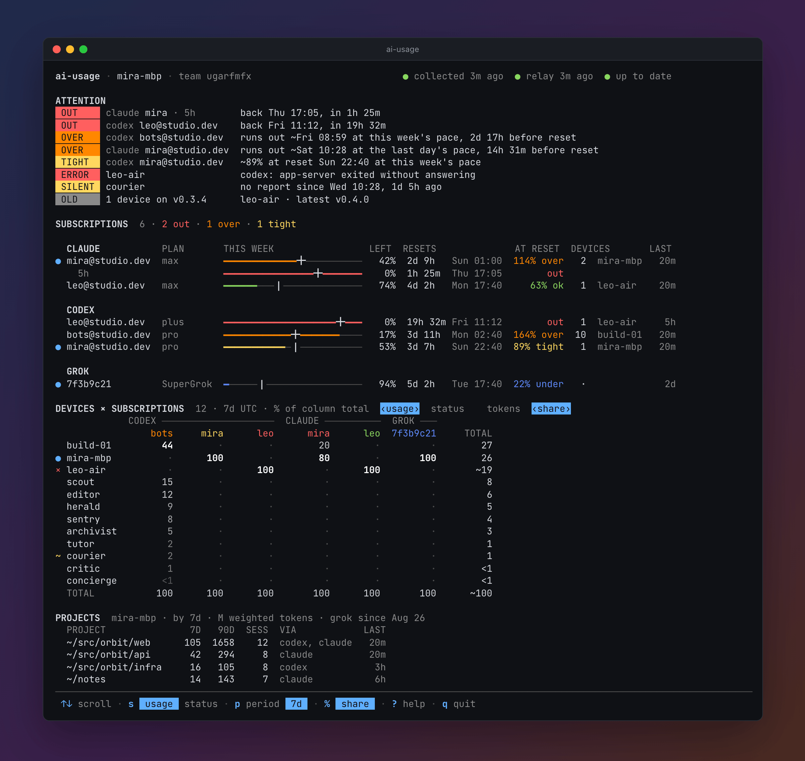

## JSON for agents

`ai-usage --json` and `ai-usage report --json` print the report as JSON with `"schema_version": 4`. A field changes meaning only with a new schema version. `usage` and `days` count input plus output tokens; `burn` and `burn_days` beside them count weighted tokens, which the page shows.

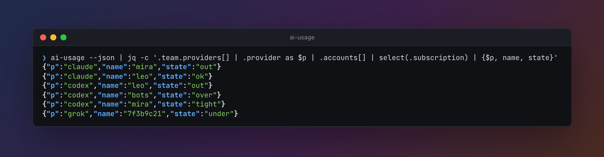

```
schema_version, generated_at
collector   version, device, team, last run, last success, last error,
            relay, schedule, and update state, and health[] as the header shows it
attention[] out, over, tight, outside, error, no_reading, silent, duplicate, old, under, idle, check, cost: the account or
            devices, when, and why, and subject and text, the line as the console words it
providers[] claude, codex, grok, hermes: status (ok, partial, error, skipped), error, homes,
            covered_since, accounts[]: label, name, home, plan, state (out, over, tight, ok,
                        under, unknown), quota with from and windows[] (percent, resets_at, main,
                        limits, stale, reset, state, forecast with basis and pace), link, sessions,
                        tokens, usage (today, 7d, 30d, 90d), burn, fresh, days[], burn_days[],
                        linked_usage[], last_active_at, projects[]
projects[]  this machine's projects over every account, with usage, burn, active_sessions, and providers
team        pulled_at, latest_version, estimated, held_back_by, estimated_reason,
            devices[] (error, silent, old, usage, burn, gap, replaced_by, note, limitations), providers[]
            with accounts summed across devices (name, alias, state, quota, usage, burn, users,
            busiest, no_reading, outside, per_device[], linked_usage[]), and matrix (columns[],
            rows[] with share and burn_share, of cells with share and burn_share)
cost        currency, total_usd, used_usd, used_pct, unused_usd, without_price, next_charge, prices,
            subscriptions[] (plan, price_usd, price_source, cadence, renews_at, used_usd, used_pct,
            unused_usd, state, consumers[], plans[]), devices[], questions[], and events[] of the
            last 30 days, each with an id that stays the same
```

`ai-usage status --json` prints `schema_version`, `collector`, `sources[]`, and `install`: the version, the binary, how it updates, the state folder, whether it has collected, and what the scheduler runs. Before the first run it creates nothing, with `collector` `null`, so an installer or another app can ask first. Every field is described in [docs/json-schema.md](docs/json-schema.md).

## Privacy

A snapshot is what goes to the relay. It is at most 64 KB, and the relay rejects any field it does not know. Apart from it, ai-usage sends its author [usage stats](#usage-stats), and asks GitHub for [updates](#updates).

Sealed with the team key, so only the team can read them:

- the machine's name (its host name, unless `ai-usage name set` gave it another) and OS user name
- account labels, such as an email address
- project folder paths
- error messages
- the names `ai-usage alias` gave accounts
- what people typed with `ai-usage cost`: prices, cadences, charge days, and that a subscription is still paid or was cancelled, each with the label of its account

In plain text, so the relay can check the shape:

- the team fingerprint, the device id (random), and the collector version
- provider names, plan names, and whether an account is logged in; from v0.10.0 a Claude Max plan names its tier, as `max 20x`
- the provider and time of each cost answer
- quota window names, percentages, and reset times
- session and token counts, tokens and weighted tokens per day and since each quota window began, and timestamps
- each tool's status: ok, partial, error, or skipped

So the relay's operator can see how many machines a team has, which tools and plans they use, and so roughly what they pay at list prices, how much, and when, but not who, on which machine, or in which project, nor the prices the team typed. The operator also sees the IP addresses that connect, which the relay keeps in rate-limit counters for up to a day.

Once a day each collector also asks the relay for its price list, `GET /v1/prices`, which needs no key and carries nothing of the team. Who bills a Claude subscription, such as the App Store, and when it began, as Claude Code says, stay on the machine.

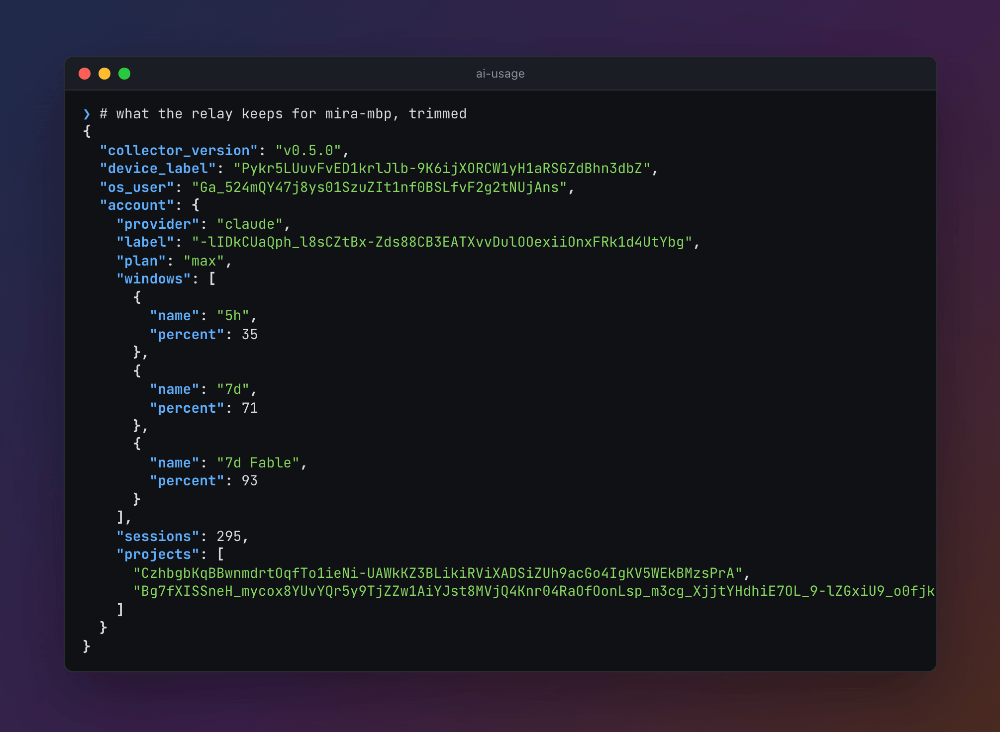

Every snapshot is signed with the team key, and each machine checks the signatures of what it reads. The relay cannot forge or change a snapshot without being noticed. It can withhold one, delete one, or keep serving an older one.

The state folder on your machine keeps account labels and project paths in plain text.

### Usage stats

ai-usage sends its author usage stats: how often it runs, which commands and parts of the menu bar app are used, and what fails, so he can see which releases and features people use and fix what breaks. They go to [PostHog](https://posthog.com), which processes them for him, through `usage.sergeybaus.com`, and never to the relay. [usage.sergeybaus.com](https://usage.sergeybaus.com) shows what is sent and the totals.

Each event is one of:

- installed, the first time this install sends anything, and started, at each run
- a command ran, by its name alone, such as `collect`, `report`, or `team`; for the menu bar app, that it started or that its popover, Team window, or Settings opened
- a command failed, with the error's type, such as `ENOENT`; for `collect`, `report`, `status`, `schedule`, `update`, and `app`, also its text, with your home folder as `~` and your user name as `<user>`, cut to 300 characters. The other commands, whose errors can repeat an account, a device, a key, or a relay you typed, and `report --from`, send the type alone; so does a tool that failed in a collection, as `source claude`

with the ai-usage version, the OS and its version, the CPU, the Go version, how ai-usage was installed (Homebrew, the installer, or a binary), how it runs (in a terminal, for an AI agent and which one, from a script, from the scheduler or `ai-usage schedule run`, as `ai-usage relay serve`, or for the menu bar app), and a random install id, kept in `telemetry.json` in the state folder. PostHog sees the IP address the request comes from, and takes the country from it. ai-usage never sends your files, folder or project names, arguments, account names or emails, host or device names, the team key, or the report's numbers.

Nothing is sent until the notice has been shown once:

```
ai-usage shares usage stats with its author: how often it runs, which features are used, errors, version and OS, tied to a random install ID. It never sends your files, arguments or account names. Nothing has been sent yet. Turn it off with `ai-usage telemetry off` or `DO_NOT_TRACK=1`. Details: https://usage.sergeybaus.com
```

The installers print it, and so does the first `ai-usage` on a terminal or for an AI agent, on standard error; the menu bar app shows it once in the popover, with OK and Turn Off. The run that shows it sends nothing. A run from the scheduler shows nobody the notice, and sends nothing until someone has seen it. Runs from the scheduler or from a script, such as a status bar that runs ai-usage every minute, send at most one of each event a day. The menu bar app's and BB's own runs of `ai-usage`, such as the report the app reads every minute, send nothing; the app sends only its events above. Nothing is sent in CI, in tests, or from a development build. An event is one HTTPS request in the background, given 3 seconds, and a run waits at most half a second for it before it exits.

To turn usage stats off:

- `ai-usage telemetry off`, or Share Usage Stats in the menu bar app's Settings, which also forgets the install id; `ai-usage telemetry on` turns them on again
- `DO_NOT_TRACK=1` or `AI_USAGE_TELEMETRY=0` in the environment. A launch agent, a crontab line, a scheduled task, or the menu bar app does not see your shell's variables, so to stop the scheduler's runs and the app's events too, use `ai-usage telemetry off` or the app's switch

`ai-usage telemetry` says whether they are on, and which of these decided. A packager can build ai-usage without them with `-ldflags "-X github.com/neoromantic/ai-usage/internal/telemetry.endpoint="`.

## Updates

A release build checks GitHub for a new release at every scheduled run, so every machine the installer set up installs a release within about 15 minutes of its publication; Homebrew's copies update [with brew](#with-homebrew). A run you start less than 10 minutes after a check, such as `r` in the interactive view, does not check again, even when that check failed; a failed check is tried again by the next scheduled run. The check reads which release `github.com/neoromantic/ai-usage/releases/latest` redirects to, not the GitHub API, which allows 60 requests an hour per IP address without a token: a host with many collectors behind one address would come close to that. When there is a newer `vX.Y.Z` release, it downloads the file for this OS and CPU from that release, checks it against `checksums.txt` from the same release, runs it once with `version`, and replaces its own binary only if the new one starts and reports that release. That run finishes on the old binary; the next run is the update, which launchd on macOS 27 can refuse once, as [Troubleshooting](#a-mac-missed-a-run-after-an-update) says. `ai-usage update` checks right away.

The check also runs when a collection fails, for example on a state file this version cannot read, or on a bug that stops the run. A release that breaks collection can then still be replaced by the one that fixes it. Finding the latest release gives up after 30 seconds, so a slow GitHub holds up a run only that long. A download may take several minutes on a slow link; it is dropped only when no data arrives for a minute.

Self-update cannot be turned off for a script install. It skips prereleases, such as `v1.3.0-rc.1`. A binary in a folder you cannot write to cannot update itself, and `ai-usage status` shows that error. A release that downloads but does not install, for example one that does not start on this machine, is not downloaded again for 6 hours, and its error stays in `ai-usage status`; runs still look for a newer release, and `ai-usage update` tries again at once. Rerunning the installer also upgrades.

The team sees why a machine does not update itself. While its last check failed, its snapshot carries the error, from the next run on, and the status view's NOTE shows it; on a machine that runs an older release, it is an error in ATTENTION too. Once your machine's reads of the team have found another reporting on the same older release for 7 hours, longer than any release takes to update itself, NOTE says how long it has not updated, and so does OLD in ATTENTION. The hours count from its first run found after a newer release was out, so a laptop that was closed meanwhile is not counted, and they start again after it has not reported for a day. A GitHub refusal names its reason, such as a rate limit, without your IP address.

On macOS, the check also keeps the [menu bar app](#menu-bar-app) at the binary's release, once the binary is at it. When `~/Applications/AI Usage.app` is an earlier release, it downloads `ai-usage_darwin_app.zip` from the binary's release, checks it against `checksums.txt`, unpacks it beside the app, requires the unpacked app to report that release, and swaps it in with two renames. The running app sees the new version on disk and restarts into it. An app built from source, which reports no release, is left alone, and a missing one is not installed. A failure is an update error in `ai-usage status` that starts with `menu bar app:`. An app that downloads but does not install is, like a release, not downloaded again for 6 hours; `ai-usage update` tries again at once, and says what became of the binary first.

The checksum guards against a broken download. It does not protect against a compromised release, since both files come from the same place.

### With Homebrew

A copy Homebrew installed never replaces itself: Homebrew owns its files. Each run still checks GitHub, so the report says when a release is out, `v0.8.1 is out; run brew upgrade neoromantic/tap/ai-usage or ai-usage update` in `ai-usage status`, and the JSON's `collector.update` has `"method": "homebrew"` and that command. On macOS the check keeps the menu bar app at the binary's release, never ahead of it.

`ai-usage update` runs `brew upgrade neoromantic/tap/ai-usage`, with what brew prints, and so does the menu bar app's Update. When brew still has the older release, as when it read the tap a few minutes before, or `HOMEBREW_NO_AUTO_UPDATE` is set, it runs `brew update --quiet` and upgrades once more. Then the new binary brings the menu bar app to its release, has launchd start the agent so that macOS 27 refuses no scheduled run, and says `installed v0.8.1 with Homebrew; the next run uses it`, and `installed the menu bar app of v0.8.1` when it did. Otherwise it says `up to date (v0.8.1)`, and still brings the menu bar app to that release, as after a `brew upgrade` you ran yourself, with `installed the menu bar app of v0.8.1` when it did. brew gets 8 minutes, and the new binary 4 more to finish. When brew fails, `ai-usage update` says `brew upgrade failed:`, or `brew update failed:` for the second try, and the last line brew printed; when brew installed a release before it failed, that release still finishes first. As root, it refuses: Homebrew installs are per-user.

A release reaches Homebrew a few minutes after GitHub, once the release workflow has updated the tap. Until then `ai-usage update` says `Homebrew's formula is at v0.8.0; GitHub has v0.8.1, which reaches Homebrew soon`, and exits 1, after the release brew did install, if newer than this one, has finished the update. A plain `brew upgrade` works too, and the next run notices it; see [Troubleshooting](#a-mac-missed-a-run-after-an-update).

A Homebrew machine updates when someone runs `brew upgrade` or `ai-usage update` on it, not within 15 minutes. Until then it can hold back what the team turns on only once every machine runs a release that knows it, for 3 days at most, as the [Teams](#teams) section says. The report first says it `should update within 15 minutes`, as for any machine, and once it has reported on the older release for 7 hours, `mira@mira-mbp runs v0.8.0 and has not updated; run ai-usage update on it`, and its NOTE and OLD say how long it has not updated. When a collection fails while a newer release is out, its error ends with `` — `brew upgrade neoromantic/tap/ai-usage` may fix it ``.

A binary built from source reports version `devel` (`dev` before v0.4.0). It never updates itself and never registers with the scheduler on its own; run `ai-usage schedule install` for that.

## Troubleshooting

### A Mac missed a run after an update

On macOS 27, launchd pins a launch agent it loads at login to its binary's code signature. Up to v0.8.0, `ai-usage` was signed ad hoc, so that was the binary's hash, which every release changes. Later releases are signed with Developer ID, which launchd is expected to pin to the developer and the binary's identifier; these stay the same from release to release, so an update should keep the pin. If it does not, the repair below still covers it. The pin does change once, at the update from v0.8.0 or earlier to a signed release, and whenever a binary built from source, which is signed ad hoc, is replaced. Once such an update has replaced the binary, launchd refuses the agent's next start, and at the start after it repairs the pin, records the new binary for the next login, and runs it. So an update can cost one scheduled run, never more. While launchd refuses it, `launchctl print` shows:

```
$ launchctl print gui/$(id -u)/io.github.neoromantic.ai-usage | grep -E '^.(state|last exit|job state|properties) '
	state = not running
	last exit reason = OS_REASON_CODESIGNING
	job state = spawn failed
	properties = inferred program | needs LWCR update | managed LWCR | has LWCR
```

From v0.5.1, `ai-usage` saves that run where it can:

- A run you start that installs a release, such as `ai-usage update`, the menu bar app's Update button, `ai-usage`, or `r` in the view, has launchd start the agent at once when launchd pinned it (`has LWCR`). launchd refuses that start and repairs the pin at a second one, so no scheduled run is refused. The agent then collects, as at a scheduled run.
- A scheduled run that installs a release cannot: launchd does not start the agent while it runs. So launchd refuses its next run. Any run you start meanwhile, such as `ai-usage`, `ai-usage status`, `ai-usage report`, or the menu bar app reading the report, has launchd start the agent then, which repairs the pin and collects.
- `ai-usage schedule status` says when launchd refused the agent's last run, and `ai-usage status` repairs it.
- With Homebrew, `ai-usage update` and the menu bar app's Update start the agent twice, as a self-update a run you start does. A `brew upgrade` you run yourself is like a scheduled update: the menu bar app's next read of the report, or any `ai-usage` you run, notices that the release changed since the last collection and has launchd start the agent twice, which repairs the pin.

An agent launchd pinned to nothing, as on macOS 26 and earlier, is left as it is. When launchd still refuses the agent, `ai-usage status` says so, and `ai-usage schedule install` loads it again from the command line, which launchd pins to nothing until the next login. launchd still records the binary it pinned before, though, so the first run after that login can be refused once more, and launchd repairs it at the run after.

### launchd runs an old copy

launchd keeps the launch agent it loaded until the agent is loaded again or you log in again, whatever the plist says since. A scheduled run cannot load the agent without stopping itself, so when it rewrites the plist, as the installer's copy does to hand the schedule to [Homebrew's](#two-copies), launchd goes on running the old binary. If that binary is then removed, nothing collects. `ai-usage status`, `ai-usage schedule status`, and the menu bar app read what launchd has loaded, and say:

```
launchd still runs the launch agent it loaded before, for another binary path or state folder; `ai-usage schedule install` loads this one
```

or, when launchd has not loaded the agent at all, `launchd has not loaded the launch agent, so nothing runs it`. `ai-usage schedule install`, from either copy, loads the plist. Run it before you remove the installer's copy: that copy, from v0.8.x, does not read what launchd has loaded, so its own `status` still says to remove it, and a plain `ai-usage` that runs it does not load the plist. To see what launchd runs:

```sh
launchctl print gui/$(id -u)/io.github.neoromantic.ai-usage | sed -n '/^.arguments = {/,/^.}/p'
```

## Uninstall

```sh
ai-usage uninstall
```

It removes the schedule, the [menu bar app](#menu-bar-app) with the launch agent it may have written and its settings, and the binary the installer put in place. It keeps the state folder, with the team key and the history, so a later install goes on where this one stopped and registers the schedule again; `ai-usage status` shows where the folder is. It asks nothing, so a script or another app can run it, and it says what it did, a line a step. A step that fails does not stop the others, and the command then exits 1, saying which failed.

| Flag | Also |
| --- | --- |
| `--forget` | asks the relay to drop this machine from its team now, instead of letting its snapshot expire |
| `--purge` | does what `--forget` does, then removes the state folder. If no other machine is in the team, save `ai-usage team key` first: without the key, nobody can join that team again |

A copy Homebrew installed stays: `ai-usage uninstall` says to remove it with `brew uninstall neoromantic/tap/ai-usage`, after which `brew untap neoromantic/tap` removes the tap, when you use nothing else from it. A build from source stays where it is too. On Windows, which does not delete a program while it runs, it says to remove the `…\AppData\Local\Programs\ai-usage` folder; then open *Edit environment variables for your account* from the Start menu and remove that folder from `Path`.

Run it while the binary is still installed: without the binary, the launch agent or crontab line stays and fails every 15 minutes, silently. If the binary is gone already, remove the schedule by hand, on macOS with

```sh
launchctl bootout gui/$(id -u)/io.github.neoromantic.ai-usage
rm ~/Library/LaunchAgents/io.github.neoromantic.ai-usage.plist
```

and on Linux by deleting the line that ends in `# ai-usage` with `crontab -e`.

On macOS and Linux, if the installer added `~/.local/bin` to your shell profile, remove the block that starts with `# Added by the ai-usage installer`, or `conf.d/ai-usage.fish` for fish.

If you set `AI_USAGE_HOME`, run `ai-usage uninstall` with it set, so it finds that state folder.

## Build from source

Go 1.26 or newer. `go.mod` names Go 1.26.9 as its toolchain, so an older Go 1.26 downloads 1.26.9 to build, unless `GOTOOLCHAIN=local`:

```sh
go build -o ai-usage ./cmd/ai-usage
go test ./...
```

The menu bar app builds on macOS with Xcode or the Command Line Tools, and runs on macOS 14 and later. `macos/build.sh` builds it for both CPUs, signs it ad hoc, and zips it; a version that is not plain `vX.Y.Z` keeps self-update away from it. Releases sign it with Developer ID and have it notarized, as [docs/releasing.md](docs/releasing.md#signing-and-notarization) says:

```sh
(cd macos && xcrun swift run AIUsageChecks)
sh macos/build.sh v9.9.9-dev /tmp/ai-usage-app.zip
ditto -x -k /tmp/ai-usage-app.zip ~/Applications
```

How releases are built and published: [docs/releasing.md](docs/releasing.md).

## License

MIT. See [LICENSE](LICENSE).
